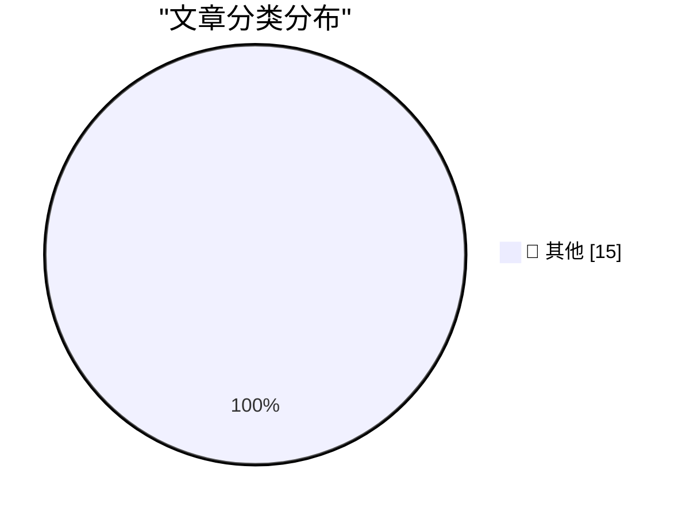

# 📰 AI 博客每日精选 — 2026-11-19

> 来自 Karpathy 推荐的 92 个顶级技术博客，AI 精选 Top 15

## 🏆 今日必读

🥇 **llm-gemini 0.38**

[llm-gemini 0.38](https://simonwillison.net/2026/Nov/18/llm-gemini/) — simonwillison.net · 18 小时前 · 📝 其他

> llm-gemini 0.38

🥈 **datasette-arrows 0.1a0**

[datasette-arrows 0.1a0](https://simonwillison.net/2026/Nov/18/datasette-arrows/) — simonwillison.net · 1 天前 · 📝 其他

> datasette-arrows 0.1a0

🥉 **Quoting Daniel Stenberg**

[Quoting Daniel Stenberg](https://simonwillison.net/2026/Nov/18/daniel-stenberg/) — simonwillison.net · 1 天前 · 📝 其他

> Quoting Daniel Stenberg

---

## 📊 数据概览

| 扫描源 | 抓取文章 | 时间范围 | 精选 |
|:---:|:---:|:---:|:---:|
| 82/92 | 2548 篇 → 28 篇 | 48h | **15 篇** |

### 分类分布

---

## 📝 其他

### 1. llm-gemini 0.38

[llm-gemini 0.38](https://simonwillison.net/2026/Nov/18/llm-gemini/) — **simonwillison.net** · 18 小时前 · ⭐ 15/30

> llm-gemini 0.38

---

### 2. datasette-arrows 0.1a0

[datasette-arrows 0.1a0](https://simonwillison.net/2026/Nov/18/datasette-arrows/) — **simonwillison.net** · 1 天前 · ⭐ 15/30

> datasette-arrows 0.1a0

---

### 3. Quoting Daniel Stenberg

[Quoting Daniel Stenberg](https://simonwillison.net/2026/Nov/18/daniel-stenberg/) — **simonwillison.net** · 1 天前 · ⭐ 15/30

> Quoting Daniel Stenberg

---

### 4. The PSF end-of-year fundraiser

[The PSF end-of-year fundraiser](https://simonwillison.net/2026/Nov/18/psf-end-of-year-fundraiser/) — **simonwillison.net** · 1 天前 · ⭐ 15/30

> The PSF end-of-year fundraiser

---

### 5. External sandboxes for coding agents

[External sandboxes for coding agents](https://simonwillison.net/2026/Nov/17/external-sandboxes-for-coding-agents/) — **simonwillison.net** · 1 天前 · ⭐ 15/30

> External sandboxes for coding agents

---

### 6. GPT‑6.2 Astra and GPT‑6.2 Sol

[GPT‑6.2 Astra and GPT‑6.2 Sol](https://simonwillison.net/2026/Nov/17/gpt62-astra-and-sol/) — **simonwillison.net** · 1 天前 · ⭐ 15/30

> GPT‑6.2 Astra and GPT‑6.2 Sol

---

### 7. Attackers Used Optimizely to A/B Test Malware on Top Websites

[Attackers Used Optimizely to A/B Test Malware on Top Websites](https://krebsonsecurity.com/2026/11/attackers-used-optimizely-to-a-b-test-malware-on-top-websites/) — **krebsonsecurity.com** · 1 天前 · ⭐ 15/30

> Attackers Used Optimizely to A/B Test Malware on Top Websites

---

### 8. Anthropic IPOs, Topping SpaceX for the Largest Ever

[Anthropic IPOs, Topping SpaceX for the Largest Ever](https://www.techmeme.com/261118/p34#a261118p34) — **daringfireball.net** · 2 小时前 · ⭐ 15/30

> Anthropic IPOs, Topping SpaceX for the Largest Ever

---

### 9. ★ The 50-Yard Line

[★ The 50-Yard Line](https://daringfireball.net/2026/11/the_50-yard_line) — **daringfireball.net** · 22 小时前 · ⭐ 15/30

> ★ The 50-Yard Line

---

### 10. Jensen Huang Tweets

[Jensen Huang Tweets](https://x.com/JensenHuang/status/2122726005219737649) — **daringfireball.net** · 1 天前 · ⭐ 15/30

> Jensen Huang Tweets

---

### 11. SO Is Back! No, Not Stack Overflow, but Its Spirit

[SO Is Back! No, Not Stack Overflow, but Its Spirit](https://idiallo.com/byte-size/stackoverflow-is-back-in-spirit) — **idiallo.com** · 11 小时前 · ⭐ 15/30

> SO Is Back! No, Not Stack Overflow, but Its Spirit

---

### 12. Pluralistic: How to forfeit one of copyright's best labor policies (19 Nov 2026)

[Pluralistic: How to forfeit one of copyright's best labor policies (19 Nov 2026)](https://pluralistic.net/2026/11/19/loan-out-companies/) — **pluralistic.net** · 4 小时前 · ⭐ 15/30

> Pluralistic: How to forfeit one of copyright's best labor policies (19 Nov 2026)

---

### 13. Pluralistic: Enshittifiers groom us for scammers (18 Nov 2026)

[Pluralistic: Enshittifiers groom us for scammers (18 Nov 2026)](https://pluralistic.net/2026/11/18/malice-v-incompetence/) — **pluralistic.net** · 1 天前 · ⭐ 15/30

> Pluralistic: Enshittifiers groom us for scammers (18 Nov 2026)

---

### 14. Theatre Review: FORT – a new opera ★★★☆☆

[Theatre Review: FORT – a new opera ★★★☆☆](https://shkspr.mobi/blog/2026/11/theatre-review-fort-a-new-opera/) — **shkspr.mobi** · 6 小时前 · ⭐ 15/30

> Theatre Review: FORT – a new opera ★★★☆☆

---

### 15. Once More Unto The Breach - Another Year In Review

[Once More Unto The Breach - Another Year In Review](https://shkspr.mobi/blog/2026/11/once-more-unto-the-breach-another-year-in-review/) — **shkspr.mobi** · 1 天前 · ⭐ 15/30

> Once More Unto The Breach - Another Year In Review

---

*生成于 2026-11-19 18:43 | 扫描 82 源 → 获取 2548 篇 → 精选 15 篇*
*基于 [Hacker News Popularity Contest 2025](https://refactoringenglish.com/tools/hn-popularity/) RSS 源列表，由 [Andrej Karpathy](https://x.com/karpathy) 推荐*
*由「懂点儿AI」制作，欢迎关注同名微信公众号获取更多 AI 实用技巧 💡*
