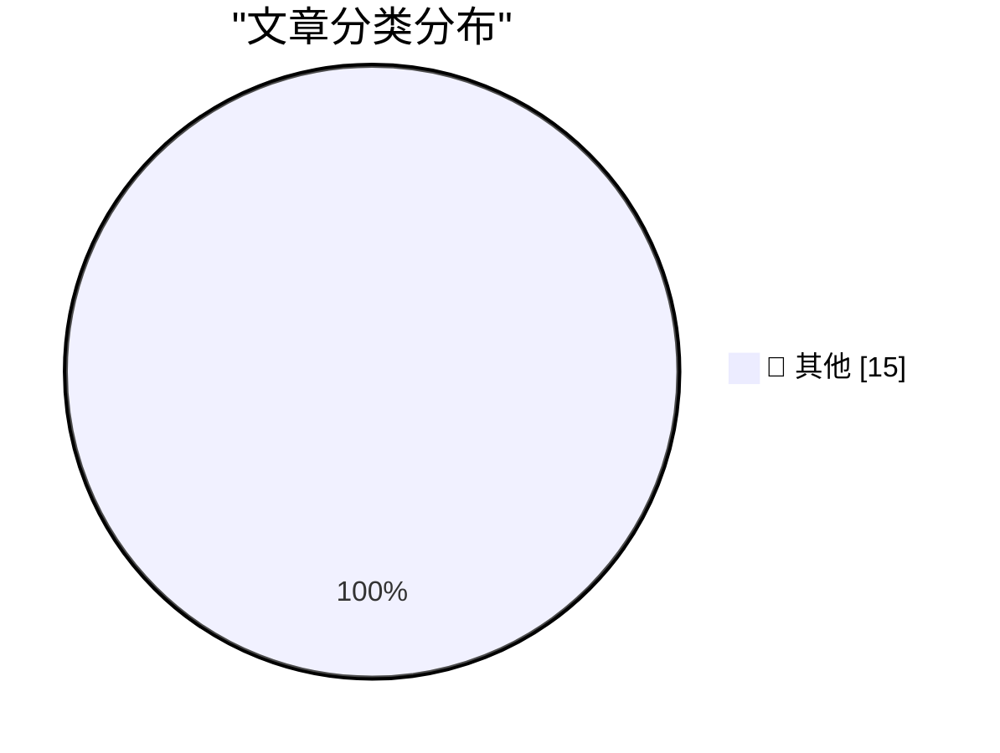

# 📰 AI 博客每日精选 — 2026-10-23

> 来自 Karpathy 推荐的 92 个顶级技术博客，AI 精选 Top 15

## 🏆 今日必读

🥇 **DE STAAT - FREEDOM (Official Music Video)**

[DE STAAT - FREEDOM (Official Music Video)](https://simonwillison.net/2026/Oct/22/de-staat-freedom/) — simonwillison.net · 18 小时前 · 📝 其他

> DE STAAT - FREEDOM (Official Music Video)

🥈 **Donating Agent Skills to the Agentic AI Foundation**

[Donating Agent Skills to the Agentic AI Foundation](https://simonwillison.net/2026/Oct/22/donating-agent-skills/) — simonwillison.net · 20 小时前 · 📝 其他

> Donating Agent Skills to the Agentic AI Foundation

🥉 **Quoting Armin Ronacher**

[Quoting Armin Ronacher](https://simonwillison.net/2026/Oct/22/armin-ronacher/) — simonwillison.net · 22 小时前 · 📝 其他

> Quoting Armin Ronacher

---

## 📊 数据概览

| 扫描源 | 抓取文章 | 时间范围 | 精选 |
|:---:|:---:|:---:|:---:|
| 83/92 | 2534 篇 → 32 篇 | 48h | **15 篇** |

### 分类分布

---

## 📝 其他

### 1. DE STAAT - FREEDOM (Official Music Video)

[DE STAAT - FREEDOM (Official Music Video)](https://simonwillison.net/2026/Oct/22/de-staat-freedom/) — **simonwillison.net** · 18 小时前 · ⭐ 15/30

> DE STAAT - FREEDOM (Official Music Video)

---

### 2. Donating Agent Skills to the Agentic AI Foundation

[Donating Agent Skills to the Agentic AI Foundation](https://simonwillison.net/2026/Oct/22/donating-agent-skills/) — **simonwillison.net** · 20 小时前 · ⭐ 15/30

> Donating Agent Skills to the Agentic AI Foundation

---

### 3. Quoting Armin Ronacher

[Quoting Armin Ronacher](https://simonwillison.net/2026/Oct/22/armin-ronacher/) — **simonwillison.net** · 22 小时前 · ⭐ 15/30

> Quoting Armin Ronacher

---

### 4. Today's PHP Security Release, and How We're Strengthening PHP Security

[Today's PHP Security Release, and How We're Strengthening PHP Security](https://simonwillison.net/2026/Oct/21/php-security-release/) — **simonwillison.net** · 1 天前 · ⭐ 15/30

> Today's PHP Security Release, and How We're Strengthening PHP Security

---

### 5. Panache — RTS Belle Époque pour mobile

[Panache — RTS Belle Époque pour mobile](https://simonwillison.net/2026/Oct/21/panache/) — **simonwillison.net** · 1 天前 · ⭐ 15/30

> Panache — RTS Belle Époque pour mobile

---

### 6. Ubiquiti's $99 Vape Detector is actually pretty good

[Ubiquiti's $99 Vape Detector is actually pretty good](https://www.jeffgeerling.com/blog/2026/ubiquiti-vape-detector-teardown/) — **jeffgeerling.com** · 1 小时前 · ⭐ 15/30

> Ubiquiti's $99 Vape Detector is actually pretty good

---

### 7. Software is slow because of bad design, not slow languages

[Software is slow because of bad design, not slow languages](https://seangoedecke.com/software-is-slow-because-of-bad-design-not-slow-languages/) — **seangoedecke.com** · 14 小时前 · ⭐ 15/30

> Software is slow because of bad design, not slow languages

---

### 8. Widespread PHP Flaw May Cause Many Site Outages Today

[Widespread PHP Flaw May Cause Many Site Outages Today](https://krebsonsecurity.com/2026/10/widespread-php-flaw-may-cause-many-site-outages-today/) — **krebsonsecurity.com** · 1 天前 · ⭐ 15/30

> Widespread PHP Flaw May Cause Many Site Outages Today

---

### 9. Apple Highlights 50+ iPhone Apps That Have Already Been Optimized for the Duo

[Apple Highlights 50+ iPhone Apps That Have Already Been Optimized for the Duo](https://www.apple.com/newsroom/2026/10/developers-bring-incredible-new-app-experiences-to-iphone-duo/) — **daringfireball.net** · 19 小时前 · ⭐ 15/30

> Apple Highlights 50+ iPhone Apps That Have Already Been Optimized for the Duo

---

### 10. Updates to My iPhone Duo Review

[Updates to My iPhone Duo Review](https://daringfireball.net/2026/10/the_iphone_duo) — **daringfireball.net** · 19 小时前 · ⭐ 15/30

> Updates to My iPhone Duo Review

---

### 11. ★ The iPhone Duo

[★ The iPhone Duo](https://daringfireball.net/2026/10/the_iphone_duo) — **daringfireball.net** · 1 天前 · ⭐ 15/30

> ★ The iPhone Duo

---

### 12. Productivity

[Productivity](https://idiallo.com/byte-size/productivity-video) — **idiallo.com** · 21 小时前 · ⭐ 15/30

> Productivity

---

### 13. Can they write a function?

[Can they write a function?](https://idiallo.com/blog/can-they-write-a-function) — **idiallo.com** · 1 天前 · ⭐ 15/30

> Can they write a function?

---

### 14. Pluralistic: Adversarial interoperability is a team sport (21 Oct 2026)

[Pluralistic: Adversarial interoperability is a team sport (21 Oct 2026)](https://pluralistic.net/2026/10/21/brittle-individualism/) — **pluralistic.net** · 1 天前 · ⭐ 15/30

> Pluralistic: Adversarial interoperability is a team sport (21 Oct 2026)

---

### 15. More phishing messages via Booking.com and Novotel

[More phishing messages via Booking.com and Novotel](https://shkspr.mobi/blog/2026/10/more-phishing-messages-via-booking-com-and-novotel/) — **shkspr.mobi** · 2 小时前 · ⭐ 15/30

> More phishing messages via Booking.com and Novotel

---

*生成于 2026-10-23 14:30 | 扫描 83 源 → 获取 2534 篇 → 精选 15 篇*
*基于 [Hacker News Popularity Contest 2025](https://refactoringenglish.com/tools/hn-popularity/) RSS 源列表，由 [Andrej Karpathy](https://x.com/karpathy) 推荐*
*由「懂点儿AI」制作，欢迎关注同名微信公众号获取更多 AI 实用技巧 💡*
