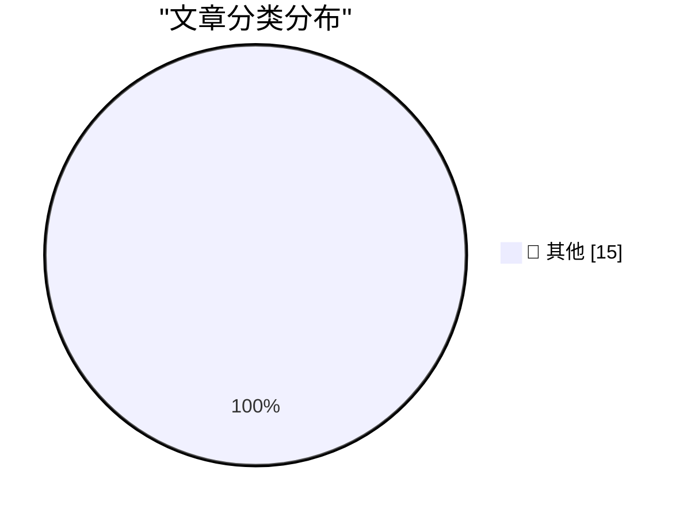

# 📰 AI 博客每日精选 — 2026-11-02

> 来自 Karpathy 推荐的 92 个顶级技术博客，AI 精选 Top 15

## 🏆 今日必读

🥇 **The U.S. Census Bureau and “Super Intelligence”**

[The U.S. Census Bureau and “Super Intelligence”](https://simonwillison.net/2026/Nov/2/census-bureau-super-intelligence/) — simonwillison.net · 6 小时前 · 📝 其他

> The U.S. Census Bureau and “Super Intelligence”

🥈 **If in doubt, delete the uv.lock file**

[If in doubt, delete the uv.lock file](https://simonwillison.net/2026/Nov/1/delete-uv-lock-first/) — simonwillison.net · 20 小时前 · 📝 其他

> If in doubt, delete the uv.lock file

🥉 **Quoting Kyle Kingsbury**

[Quoting Kyle Kingsbury](https://simonwillison.net/2026/Nov/1/kyle-kingsbury/) — simonwillison.net · 1 天前 · 📝 其他

> Quoting Kyle Kingsbury

---

## 📊 数据概览

| 扫描源 | 抓取文章 | 时间范围 | 精选 |
|:---:|:---:|:---:|:---:|
| 83/92 | 2551 篇 → 18 篇 | 48h | **15 篇** |

### 分类分布

---

## 📝 其他

### 1. The U.S. Census Bureau and “Super Intelligence”

[The U.S. Census Bureau and “Super Intelligence”](https://simonwillison.net/2026/Nov/2/census-bureau-super-intelligence/) — **simonwillison.net** · 6 小时前 · ⭐ 15/30

> The U.S. Census Bureau and “Super Intelligence”

---

### 2. If in doubt, delete the uv.lock file

[If in doubt, delete the uv.lock file](https://simonwillison.net/2026/Nov/1/delete-uv-lock-first/) — **simonwillison.net** · 20 小时前 · ⭐ 15/30

> If in doubt, delete the uv.lock file

---

### 3. Quoting Kyle Kingsbury

[Quoting Kyle Kingsbury](https://simonwillison.net/2026/Nov/1/kyle-kingsbury/) — **simonwillison.net** · 1 天前 · ⭐ 15/30

> Quoting Kyle Kingsbury

---

### 4. How We Took Over ChatGPT Accounts

[How We Took Over ChatGPT Accounts](https://simonwillison.net/2026/Oct/31/how-we-took-over-chatgpt-accounts/) — **simonwillison.net** · 1 天前 · ⭐ 15/30

> How We Took Over ChatGPT Accounts

---

### 5. datasette-llm 0.1a9

[datasette-llm 0.1a9](https://simonwillison.net/2026/Oct/31/datasette-llm/) — **simonwillison.net** · 1 天前 · ⭐ 15/30

> datasette-llm 0.1a9

---

### 6. Reliably aligning LLMs is impossible in principle

[Reliably aligning LLMs is impossible in principle](https://seangoedecke.com/alignment-is-impossible/) — **seangoedecke.com** · 19 小时前 · ⭐ 15/30

> Reliably aligning LLMs is impossible in principle

---

### 7. Fast and slow ways to improve your reputation

[Fast and slow ways to improve your reputation](https://seangoedecke.com/how-to-get-assigned-interesting-work/) — **seangoedecke.com** · 1 天前 · ⭐ 15/30

> Fast and slow ways to improve your reputation

---

### 8. WorkOS: Let Agents Sign Up for Your App Without a Browser

[WorkOS: Let Agents Sign Up for Your App Without a Browser](https://workos.com/auth-md?utm_source=daringfireball&amp;utm_medium=newsletter&amp;utm_campaign=q42026) — **daringfireball.net** · 23 小时前 · ⭐ 15/30

> WorkOS: Let Agents Sign Up for Your App Without a Browser

---

### 9. Pluralistic: Autodoxing (02 Nov 2026)

[Pluralistic: Autodoxing (02 Nov 2026)](https://pluralistic.net/2026/11/02/agony-verification/) — **pluralistic.net** · 11 小时前 · ⭐ 15/30

> Pluralistic: Autodoxing (02 Nov 2026)

---

### 10. Lorem Ipsum Dot Gov Dot UK

[Lorem Ipsum Dot Gov Dot UK](https://shkspr.mobi/blog/2026/11/lorem-ipsum-dot-gov-dot-uk/) — **shkspr.mobi** · 7 小时前 · ⭐ 15/30

> Lorem Ipsum Dot Gov Dot UK

---

### 11. 10 Years on Mastodon

[10 Years on Mastodon](https://shkspr.mobi/blog/2026/11/10-years-on-mastodon/) — **shkspr.mobi** · 1 天前 · ⭐ 15/30

> 10 Years on Mastodon

---

### 12. Sneaking into the auditorium for the Windows 2000 launch rehearsal

[Sneaking into the auditorium for the Windows 2000 launch rehearsal](https://devblogs.microsoft.com/oldnewthing/20261102-00/?p=112818/) — **devblogs.microsoft.com/oldnewthing** · 4 小时前 · ⭐ 15/30

> Sneaking into the auditorium for the Windows 2000 launch rehearsal

---

### 13. Making peace with the projective plane

[Making peace with the projective plane](https://www.johndcook.com/blog/2026/11/02/projective-plane/) — **johndcook.com** · 5 小时前 · ⭐ 15/30

> Making peace with the projective plane

---

### 14. A unified view of poles and polars

[A unified view of poles and polars](https://www.johndcook.com/blog/2026/11/01/projective-poles-and-polars/) — **johndcook.com** · 23 小时前 · ⭐ 15/30

> A unified view of poles and polars

---

### 15. A Mastodon bot powered by iOS Shortcuts

[A Mastodon bot powered by iOS Shortcuts](https://evanhahn.com/mastodon-bot-with-ios-shortcuts/) — **evanhahn.com** · 1 天前 · ⭐ 15/30

> A Mastodon bot powered by iOS Shortcuts

---

*生成于 2026-11-02 19:51 | 扫描 83 源 → 获取 2551 篇 → 精选 15 篇*
*基于 [Hacker News Popularity Contest 2025](https://refactoringenglish.com/tools/hn-popularity/) RSS 源列表，由 [Andrej Karpathy](https://x.com/karpathy) 推荐*
*由「懂点儿AI」制作，欢迎关注同名微信公众号获取更多 AI 实用技巧 💡*
