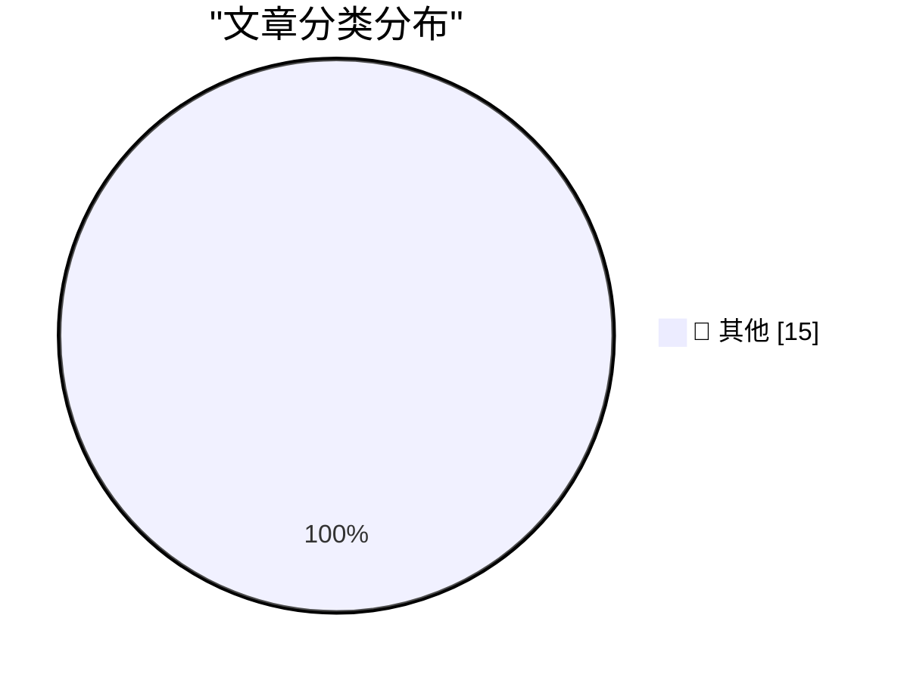

# 📰 AI 博客每日精选 — 2026-11-12

> 来自 Karpathy 推荐的 92 个顶级技术博客，AI 精选 Top 15

## 🏆 今日必读

🥇 **Gemini Decisions API**

[Gemini Decisions API](https://simonwillison.net/2026/Nov/11/gemini-decisions-api/) — simonwillison.net · 19 小时前 · 📝 其他

> Gemini Decisions API

🥈 **aws-emulator**

[aws-emulator](https://simonwillison.net/2026/Nov/11/aws-emulator/) — simonwillison.net · 20 小时前 · 📝 其他

> aws-emulator

🥉 **Browse tools.simonwillison.net by tag**

[Browse tools.simonwillison.net by tag](https://simonwillison.net/2026/Nov/11/tools-tags/) — simonwillison.net · 23 小时前 · 📝 其他

> Browse tools.simonwillison.net by tag

---

## 📊 数据概览

| 扫描源 | 抓取文章 | 时间范围 | 精选 |
|:---:|:---:|:---:|:---:|
| 82/92 | 2536 篇 → 40 篇 | 48h | **15 篇** |

### 分类分布

---

## 📝 其他

### 1. Gemini Decisions API

[Gemini Decisions API](https://simonwillison.net/2026/Nov/11/gemini-decisions-api/) — **simonwillison.net** · 19 小时前 · ⭐ 15/30

> Gemini Decisions API

---

### 2. aws-emulator

[aws-emulator](https://simonwillison.net/2026/Nov/11/aws-emulator/) — **simonwillison.net** · 20 小时前 · ⭐ 15/30

> aws-emulator

---

### 3. Browse tools.simonwillison.net by tag

[Browse tools.simonwillison.net by tag](https://simonwillison.net/2026/Nov/11/tools-tags/) — **simonwillison.net** · 23 小时前 · ⭐ 15/30

> Browse tools.simonwillison.net by tag

---

### 4. llm 0.37.2

[llm 0.37.2](https://simonwillison.net/2026/Nov/11/llm/) — **simonwillison.net** · 1 天前 · ⭐ 15/30

> llm 0.37.2

---

### 5. Anthropic's IPO roadshow video

[Anthropic's IPO roadshow video](https://simonwillison.net/2026/Nov/11/anthropic-ipo-roadshow/) — **simonwillison.net** · 1 天前 · ⭐ 15/30

> Anthropic's IPO roadshow video

---

### 6. llm-gemini 0.36

[llm-gemini 0.36](https://simonwillison.net/2026/Nov/10/llm-gemini/) — **simonwillison.net** · 1 天前 · ⭐ 15/30

> llm-gemini 0.36

---

### 7. Glue work is still harmful in the age of AI

[Glue work is still harmful in the age of AI](https://seangoedecke.com/glue-work-is-still-harmful-in-the-age-of-ai/) — **seangoedecke.com** · 1 天前 · ⭐ 15/30

> Glue work is still harmful in the age of AI

---

### 8. Who Runs the Ransomware Group Qilin?

[Who Runs the Ransomware Group Qilin?](https://krebsonsecurity.com/2026/11/who-runs-the-ransomware-group-qilin/) — **krebsonsecurity.com** · 23 小时前 · ⭐ 15/30

> Who Runs the Ransomware Group Qilin?

---

### 9. Microsoft Fixes Nearly 1,100 Security Vulnerabilities

[Microsoft Fixes Nearly 1,100 Security Vulnerabilities](https://krebsonsecurity.com/2026/11/microsoft-fixes-nearly-1100-security-vulnerabilities/) — **krebsonsecurity.com** · 1 天前 · ⭐ 15/30

> Microsoft Fixes Nearly 1,100 Security Vulnerabilities

---

### 10. Trump Weighs in on Huang’s Successor

[Trump Weighs in on Huang’s Successor](https://truthsocial.com/@realDonaldTrump/posts/117604177898784579) — **daringfireball.net** · 14 分钟前 · ⭐ 15/30

> Trump Weighs in on Huang’s Successor

---

### 11. Jensen Huang’s Advice to His Successor: ‘They’ll Just Have to Reshape the Company’

[Jensen Huang’s Advice to His Successor: ‘They’ll Just Have to Reshape the Company’](https://www.ycombinator.com/library/Tq-jensen-huang-the-mindset-that-built-nvidia) — **daringfireball.net** · 1 小时前 · ⭐ 15/30

> Jensen Huang’s Advice to His Successor: ‘They’ll Just Have to Reshape the Company’

---

### 12. Jensen Huang Resigns From Nvidia

[Jensen Huang Resigns From Nvidia](https://nvidianews.nvidia.com/news/nvidia-announces-ceo-transition) — **daringfireball.net** · 2 小时前 · ⭐ 15/30

> Jensen Huang Resigns From Nvidia

---

### 13. Semafor: ‘Nvidia Board Preparing to Oust CEO Jensen Huang, Name Interim CEO’

[Semafor: ‘Nvidia Board Preparing to Oust CEO Jensen Huang, Name Interim CEO’](https://www.semafor.com/article/11/11/2026/nvidia-board-preparing-to-oust-ceo-huang-wsj) — **daringfireball.net** · 12 小时前 · ⭐ 15/30

> Semafor: ‘Nvidia Board Preparing to Oust CEO Jensen Huang, Name Interim CEO’

---

### 14. Nvidia Working With Outside Firm to Identify CEO Candidates

[Nvidia Working With Outside Firm to Identify CEO Candidates](https://www.bloomberg.com/news/articles/2026-11-11/nvidia-working-with-outside-firm-to-identify-ceo-candidates) — **daringfireball.net** · 13 小时前 · ⭐ 15/30

> Nvidia Working With Outside Firm to Identify CEO Candidates

---

### 15. WSJ: ‘Nvidia Is Preparing to Oust CEO Jensen Huang’

[WSJ: ‘Nvidia Is Preparing to Oust CEO Jensen Huang’](https://www.wsj.com/business/nvidia-is-preparing-to-oust-nvidia-ceo-jensen-huang-30f421ad?st=S84MQZ) — **daringfireball.net** · 14 小时前 · ⭐ 15/30

> WSJ: ‘Nvidia Is Preparing to Oust CEO Jensen Huang’

---

*生成于 2026-11-12 17:46 | 扫描 82 源 → 获取 2536 篇 → 精选 15 篇*
*基于 [Hacker News Popularity Contest 2025](https://refactoringenglish.com/tools/hn-popularity/) RSS 源列表，由 [Andrej Karpathy](https://x.com/karpathy) 推荐*
*由「懂点儿AI」制作，欢迎关注同名微信公众号获取更多 AI 实用技巧 💡*
