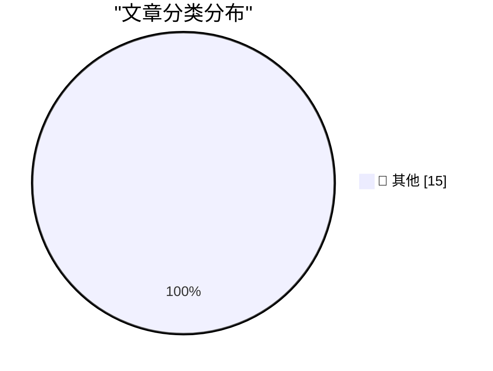

# 📰 AI 博客每日精选 — 2026-10-30

> 来自 Karpathy 推荐的 92 个顶级技术博客，AI 精选 Top 15

## 🏆 今日必读

🥇 **API credits benefit for eligible ChatGPT subscriptions**

[API credits benefit for eligible ChatGPT subscriptions](https://simonwillison.net/2026/Oct/29/api-credits/) — simonwillison.net · 17 小时前 · 📝 其他

> API credits benefit for eligible ChatGPT subscriptions

🥈 **Building a multiplayer game world with autonomous Fable-class models**

[Building a multiplayer game world with autonomous Fable-class models](https://simonwillison.net/2026/Oct/29/how-i-built-the-most-ai-pilled-company-in-the-world/) — simonwillison.net · 23 小时前 · 📝 其他

> Building a multiplayer game world with autonomous Fable-class models

🥉 **Quoting Ben Hylak**

[Quoting Ben Hylak](https://simonwillison.net/2026/Oct/29/ben-hylak/) — simonwillison.net · 1 天前 · 📝 其他

> Quoting Ben Hylak

---

## 📊 数据概览

| 扫描源 | 抓取文章 | 时间范围 | 精选 |
|:---:|:---:|:---:|:---:|
| 83/92 | 2535 篇 → 27 篇 | 48h | **15 篇** |

### 分类分布

---

## 📝 其他

### 1. API credits benefit for eligible ChatGPT subscriptions

[API credits benefit for eligible ChatGPT subscriptions](https://simonwillison.net/2026/Oct/29/api-credits/) — **simonwillison.net** · 17 小时前 · ⭐ 15/30

> API credits benefit for eligible ChatGPT subscriptions

---

### 2. Building a multiplayer game world with autonomous Fable-class models

[Building a multiplayer game world with autonomous Fable-class models](https://simonwillison.net/2026/Oct/29/how-i-built-the-most-ai-pilled-company-in-the-world/) — **simonwillison.net** · 23 小时前 · ⭐ 15/30

> Building a multiplayer game world with autonomous Fable-class models

---

### 3. Quoting Ben Hylak

[Quoting Ben Hylak](https://simonwillison.net/2026/Oct/29/ben-hylak/) — **simonwillison.net** · 1 天前 · ⭐ 15/30

> Quoting Ben Hylak

---

### 4. Quoting Ted Sanders

[Quoting Ted Sanders](https://simonwillison.net/2026/Oct/28/ted-sanders/) — **simonwillison.net** · 1 天前 · ⭐ 15/30

> Quoting Ted Sanders

---

### 5. GitHub Octoverse 2026

[GitHub Octoverse 2026](https://simonwillison.net/2026/Oct/28/github-octoverse-2026/) — **simonwillison.net** · 1 天前 · ⭐ 15/30

> GitHub Octoverse 2026

---

### 6. Rejoice, leap seconds are dead!

[Rejoice, leap seconds are dead!](https://www.jeffgeerling.com/blog/2026/rejoice-the-utc-leap-second-is-dead/) — **jeffgeerling.com** · 2 小时前 · ⭐ 15/30

> Rejoice, leap seconds are dead!

---

### 7. Elegance and intelligence are anticorrelated

[Elegance and intelligence are anticorrelated](https://seangoedecke.com/elegance-and-intelligence-are-anticorrelated/) — **seangoedecke.com** · 16 小时前 · ⭐ 15/30

> Elegance and intelligence are anticorrelated

---

### 8. You can just ask AI to do things

[You can just ask AI to do things](https://seangoedecke.com/you-can-just-ask-ai-to-do-things/) — **seangoedecke.com** · 1 天前 · ⭐ 15/30

> You can just ask AI to do things

---

### 9. Apple Drops App Store Commission by a Whopping 4 Percentage Points in Taiwan

[Apple Drops App Store Commission by a Whopping 4 Percentage Points in Taiwan](https://developer.apple.com/news/?id=w9mxlhek) — **daringfireball.net** · 19 小时前 · ⭐ 15/30

> Apple Drops App Store Commission by a Whopping 4 Percentage Points in Taiwan

---

### 10. A Health Update From Craig Hockenberry

[A Health Update From Craig Hockenberry](https://furbo.org/2026/10/28/a-health-update/) — **daringfireball.net** · 20 小时前 · ⭐ 15/30

> A Health Update From Craig Hockenberry

---

### 11. Rolfe Winkler at The WSJ: ‘The Beleaguered Chip Sellers Getting Their Revenge on Apple’

[Rolfe Winkler at The WSJ: ‘The Beleaguered Chip Sellers Getting Their Revenge on Apple’](https://www.wsj.com/tech/apple-iphone-memory-chips-ai-c0084cc9?st=FNAyaT) — **daringfireball.net** · 20 小时前 · ⭐ 15/30

> Rolfe Winkler at The WSJ: ‘The Beleaguered Chip Sellers Getting Their Revenge on Apple’

---

### 12. The Space Shuttle Discovery’s Starboard Side ‘s’ Is Upside Down

[The Space Shuttle Discovery’s Starboard Side ‘s’ Is Upside Down](https://www.theautopian.com/a-typography-geek-pointed-out-something-about-the-space-shuttle-discovery-and-now-i-cant-unsee-it/) — **daringfireball.net** · 1 天前 · ⭐ 15/30

> The Space Shuttle Discovery’s Starboard Side ‘s’ Is Upside Down

---

### 13. Steven Levy on the New MacBook Pro, With, Yes, a Touchscreen

[Steven Levy on the New MacBook Pro, With, Yes, a Touchscreen](https://www.wired.com/story/the-inside-story-of-why-apple-finally-brought-a-touch-display-to-the-mac/) — **daringfireball.net** · 1 天前 · ⭐ 15/30

> Steven Levy on the New MacBook Pro, With, Yes, a Touchscreen

---

### 14. Book Review: The God of Small Things by Arundhati Roy ★★☆☆☆

[Book Review: The God of Small Things by Arundhati Roy ★★☆☆☆](https://shkspr.mobi/blog/2026/10/book-review-the-god-of-small-things-by-arundhati-roy/) — **shkspr.mobi** · 3 小时前 · ⭐ 15/30

> Book Review: The God of Small Things by Arundhati Roy ★★☆☆☆

---

### 15. "No way to prevent this" say users of only language where this regularly happens

["No way to prevent this" say users of only language where this regularly happens](https://xeiaso.net/shitposts/no-way-to-prevent-this/memory-safety/CVE-2026-98432/) — **xeiaso.net** · 1 天前 · ⭐ 15/30

> "No way to prevent this" say users of only language where this regularly happens

---

*生成于 2026-10-30 16:18 | 扫描 83 源 → 获取 2535 篇 → 精选 15 篇*
*基于 [Hacker News Popularity Contest 2025](https://refactoringenglish.com/tools/hn-popularity/) RSS 源列表，由 [Andrej Karpathy](https://x.com/karpathy) 推荐*
*由「懂点儿AI」制作，欢迎关注同名微信公众号获取更多 AI 实用技巧 💡*
