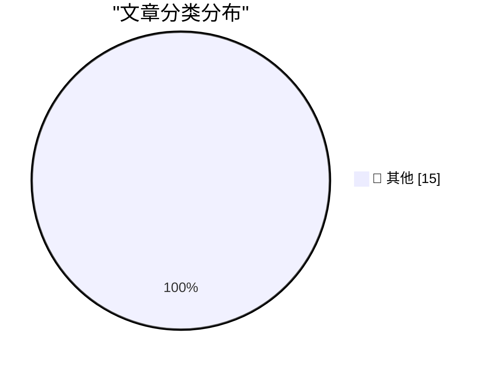

# 📰 AI 博客每日精选 — 2026-11-23

> 来自 Karpathy 推荐的 92 个顶级技术博客，AI 精选 Top 15

## 🏆 今日必读

🥇 **Select Styling Specimens**

[Select Styling Specimens](https://simonwillison.net/2026/Nov/22/select-styling/) — simonwillison.net · 1 天前 · 📝 其他

> Select Styling Specimens

🥈 **Muru**

[Muru](https://simonwillison.net/2026/Nov/21/muru/) — simonwillison.net · 1 天前 · 📝 其他

> Muru

🥉 **When in doubt, flail about**

[When in doubt, flail about](https://seangoedecke.com/when-in-doubt-flail-about/) — seangoedecke.com · 21 小时前 · 📝 其他

> When in doubt, flail about

---

## 📊 数据概览

| 扫描源 | 抓取文章 | 时间范围 | 精选 |
|:---:|:---:|:---:|:---:|
| 81/92 | 2475 篇 → 26 篇 | 48h | **15 篇** |

### 分类分布

---

## 📝 其他

### 1. Select Styling Specimens

[Select Styling Specimens](https://simonwillison.net/2026/Nov/22/select-styling/) — **simonwillison.net** · 1 天前 · ⭐ 15/30

> Select Styling Specimens

---

### 2. Muru

[Muru](https://simonwillison.net/2026/Nov/21/muru/) — **simonwillison.net** · 1 天前 · ⭐ 15/30

> Muru

---

### 3. When in doubt, flail about

[When in doubt, flail about](https://seangoedecke.com/when-in-doubt-flail-about/) — **seangoedecke.com** · 21 小时前 · ⭐ 15/30

> When in doubt, flail about

---

### 4. Notes on OpenAI's perplexity reveal

[Notes on OpenAI's perplexity reveal](https://seangoedecke.com/notes-on-openais-perplexity-reveal/) — **seangoedecke.com** · 21 小时前 · ⭐ 15/30

> Notes on OpenAI's perplexity reveal

---

### 5. To code well, avoid blunders

[To code well, avoid blunders](https://seangoedecke.com/to-code-well-avoid-blunders/) — **seangoedecke.com** · 1 天前 · ⭐ 15/30

> To code well, avoid blunders

---

### 6. Donald Trump on Jensen Huang’s Reinstatement at Nvidia

[Donald Trump on Jensen Huang’s Reinstatement at Nvidia](https://truthsocial.com/@realDonaldTrump/posts/117666713950631493) — **daringfireball.net** · 4 小时前 · ⭐ 15/30

> Donald Trump on Jensen Huang’s Reinstatement at Nvidia

---

### 7. Semafor: ‘Hours Before Huang’s Reinstatement, Trump Called Nvidia’s Board to Argue for His Return’

[Semafor: ‘Hours Before Huang’s Reinstatement, Trump Called Nvidia’s Board to Argue for His Return’](https://www.semafor.com/article/11/23/2026/jensen-huang-reinstated-as-nvidia-ceo) — **daringfireball.net** · 5 小时前 · ⭐ 15/30

> Semafor: ‘Hours Before Huang’s Reinstatement, Trump Called Nvidia’s Board to Argue for His Return’

---

### 8. Government Regulation and Demand

[Government Regulation and Demand](https://stratechery.com/2026/obituaries/) — **daringfireball.net** · 6 小时前 · ⭐ 15/30

> Government Regulation and Demand

---

### 9. Elon Musk Claims to Be Unfamiliar With MAGA

[Elon Musk Claims to Be Unfamiliar With MAGA](https://www.usatoday.com/story/opinion/columnist/2026/11/19/musk-maga-trump-republicans-billionaires/92855121007/) — **daringfireball.net** · 6 小时前 · ⭐ 15/30

> Elon Musk Claims to Be Unfamiliar With MAGA

---

### 10. Nvidia Board Reinstates Jensen Huang

[Nvidia Board Reinstates Jensen Huang](https://nvidianews.nvidia.com/news/nvidia-board-reinstates-jensen-huang-as-president-ceo-and-board-director) — **daringfireball.net** · 7 小时前 · ⭐ 15/30

> Nvidia Board Reinstates Jensen Huang

---

### 11. Ivy

[Ivy](https://semantical.com/?utm_campaign=df-2026-12) — **daringfireball.net** · 22 小时前 · ⭐ 15/30

> Ivy

---

### 12. Pluralistic: The Debt Trap (23 Nov 2026)

[Pluralistic: The Debt Trap (23 Nov 2026)](https://pluralistic.net/2026/11/23/grasshoppers-v-ants/) — **pluralistic.net** · 8 小时前 · ⭐ 15/30

> Pluralistic: The Debt Trap (23 Nov 2026)

---

### 13. Gadget Review: Cheap Zigbee Environmental Sensors ★★★☆☆

[Gadget Review: Cheap Zigbee Environmental Sensors ★★★☆☆](https://shkspr.mobi/blog/2026/11/gadget-review-cheap-zigbee-environmental-sensors/) — **shkspr.mobi** · 9 小时前 · ⭐ 15/30

> Gadget Review: Cheap Zigbee Environmental Sensors ★★★☆☆

---

### 14. I don't enjoy being pampered

[I don't enjoy being pampered](https://shkspr.mobi/blog/2026/11/i-dont-enjoy-being-pampered/) — **shkspr.mobi** · 1 天前 · ⭐ 15/30

> I don't enjoy being pampered

---

### 15. Two generators suffice

[Two generators suffice](https://www.johndcook.com/blog/2026/11/23/two-generators-suffice/) — **johndcook.com** · 4 小时前 · ⭐ 15/30

> Two generators suffice

---

*生成于 2026-11-23 21:46 | 扫描 81 源 → 获取 2475 篇 → 精选 15 篇*
*基于 [Hacker News Popularity Contest 2025](https://refactoringenglish.com/tools/hn-popularity/) RSS 源列表，由 [Andrej Karpathy](https://x.com/karpathy) 推荐*
*由「懂点儿AI」制作，欢迎关注同名微信公众号获取更多 AI 实用技巧 💡*
