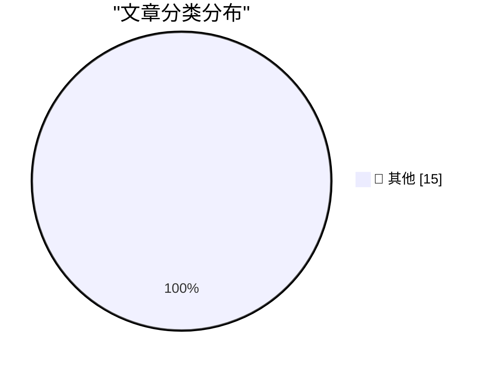

# 📰 AI 博客每日精选 — 2026-11-18

> 来自 Karpathy 推荐的 92 个顶级技术博客，AI 精选 Top 15

## 🏆 今日必读

🥇 **Quoting Daniel Stenberg**

[Quoting Daniel Stenberg](https://simonwillison.net/2026/Nov/18/daniel-stenberg/) — simonwillison.net · 2 小时前 · 📝 其他

> Quoting Daniel Stenberg

🥈 **The PSF end-of-year fundraiser**

[The PSF end-of-year fundraiser](https://simonwillison.net/2026/Nov/18/psf-end-of-year-fundraiser/) — simonwillison.net · 3 小时前 · 📝 其他

> The PSF end-of-year fundraiser

🥉 **External sandboxes for coding agents**

[External sandboxes for coding agents](https://simonwillison.net/2026/Nov/17/external-sandboxes-for-coding-agents/) — simonwillison.net · 19 小时前 · 📝 其他

> External sandboxes for coding agents

---

## 📊 数据概览

| 扫描源 | 抓取文章 | 时间范围 | 精选 |
|:---:|:---:|:---:|:---:|
| 82/92 | 2548 篇 → 35 篇 | 48h | **15 篇** |

### 分类分布

---

## 📝 其他

### 1. Quoting Daniel Stenberg

[Quoting Daniel Stenberg](https://simonwillison.net/2026/Nov/18/daniel-stenberg/) — **simonwillison.net** · 2 小时前 · ⭐ 15/30

> Quoting Daniel Stenberg

---

### 2. The PSF end-of-year fundraiser

[The PSF end-of-year fundraiser](https://simonwillison.net/2026/Nov/18/psf-end-of-year-fundraiser/) — **simonwillison.net** · 3 小时前 · ⭐ 15/30

> The PSF end-of-year fundraiser

---

### 3. External sandboxes for coding agents

[External sandboxes for coding agents](https://simonwillison.net/2026/Nov/17/external-sandboxes-for-coding-agents/) — **simonwillison.net** · 19 小时前 · ⭐ 15/30

> External sandboxes for coding agents

---

### 4. GPT‑6.2 Astra and GPT‑6.2 Sol

[GPT‑6.2 Astra and GPT‑6.2 Sol](https://simonwillison.net/2026/Nov/17/gpt62-astra-and-sol/) — **simonwillison.net** · 19 小时前 · ⭐ 15/30

> GPT‑6.2 Astra and GPT‑6.2 Sol

---

### 5. Running the full server-side Datasette Python app in the browser with service workers and Pyodide

[Running the full server-side Datasette Python app in the browser with service workers and Pyodide](https://simonwillison.net/2026/Nov/17/datasette-lite/) — **simonwillison.net** · 1 天前 · ⭐ 15/30

> Running the full server-side Datasette Python app in the browser with service workers and Pyodide

---

### 6. Quoting Go Proverbs

[Quoting Go Proverbs](https://simonwillison.net/2026/Nov/17/go-proverbs/) — **simonwillison.net** · 1 天前 · ⭐ 15/30

> Quoting Go Proverbs

---

### 7. llm 0.37.3

[llm 0.37.3](https://simonwillison.net/2026/Nov/16/llm/) — **simonwillison.net** · 1 天前 · ⭐ 15/30

> llm 0.37.3

---

### 8. I joined the NTP Pool, but not with my Stratum 1 Pi

[I joined the NTP Pool, but not with my Stratum 1 Pi](https://www.jeffgeerling.com/blog/2026/i-joined-the-ntp-pool/) — **jeffgeerling.com** · 1 天前 · ⭐ 15/30

> I joined the NTP Pool, but not with my Stratum 1 Pi

---

### 9. Attackers Used Optimizely to A/B Test Malware on Top Websites

[Attackers Used Optimizely to A/B Test Malware on Top Websites](https://krebsonsecurity.com/2026/11/attackers-used-optimizely-to-a-b-test-malware-on-top-websites/) — **krebsonsecurity.com** · 15 小时前 · ⭐ 15/30

> Attackers Used Optimizely to A/B Test Malware on Top Websites

---

### 10. Jensen Huang Tweets

[Jensen Huang Tweets](https://x.com/JensenHuang/status/2122726005219737649) — **daringfireball.net** · 2 小时前 · ⭐ 15/30

> Jensen Huang Tweets

---

### 11. SetShot 1.0 (and a Personal Tale of Defaults System Spelunking)

[SetShot 1.0 (and a Personal Tale of Defaults System Spelunking)](https://tidbits.com/2026/11/13/setshot-1-0-tracks-even-more-macos-settings/) — **daringfireball.net** · 23 小时前 · ⭐ 15/30

> SetShot 1.0 (and a Personal Tale of Defaults System Spelunking)

---

### 12. Apple’s Cloud Services Are Having a Bad Day, Including Their Status Page

[Apple’s Cloud Services Are Having a Bad Day, Including Their Status Page](https://www.macrumors.com/2026/11/17/apple-accounts-experiencing-issues/) — **daringfireball.net** · 1 天前 · ⭐ 15/30

> Apple’s Cloud Services Are Having a Bad Day, Including Their Status Page

---

### 13. Apple Support Document on the New ‘Full Disk Access’ and ‘System & App Protection Override’ Settings in MacOS 27.3 Beta 2

[Apple Support Document on the New ‘Full Disk Access’ and ‘System & App Protection Override’ Settings in MacOS 27.3 Beta 2](https://support.apple.com/en-us/149699) — **daringfireball.net** · 1 天前 · ⭐ 15/30

> Apple Support Document on the New ‘Full Disk Access’ and ‘System & App Protection Override’ Settings in MacOS 27.3 Beta 2

---

### 14. ‘Meet the Anthropic Researcher Behind Silicon Valley’s “Consensual Non-Consent” Orgies’

[‘Meet the Anthropic Researcher Behind Silicon Valley’s “Consensual Non-Consent” Orgies’](https://freebeacon.com/america/horrifying-meet-the-anthropic-researcher-behind-silicon-valleys-consensual-non-consent-orgies/) — **daringfireball.net** · 1 天前 · ⭐ 15/30

> ‘Meet the Anthropic Researcher Behind Silicon Valley’s “Consensual Non-Consent” Orgies’

---

### 15. [Sponsor] Ivy: The To-do List That Ends

[[Sponsor] Ivy: The To-do List That Ends](https://semantical.com/?utm_campaign=df-2026-12) — **daringfireball.net** · 1 天前 · ⭐ 15/30

> [Sponsor] Ivy: The To-do List That Ends

---

*生成于 2026-11-18 18:28 | 扫描 82 源 → 获取 2548 篇 → 精选 15 篇*
*基于 [Hacker News Popularity Contest 2025](https://refactoringenglish.com/tools/hn-popularity/) RSS 源列表，由 [Andrej Karpathy](https://x.com/karpathy) 推荐*
*由「懂点儿AI」制作，欢迎关注同名微信公众号获取更多 AI 实用技巧 💡*
