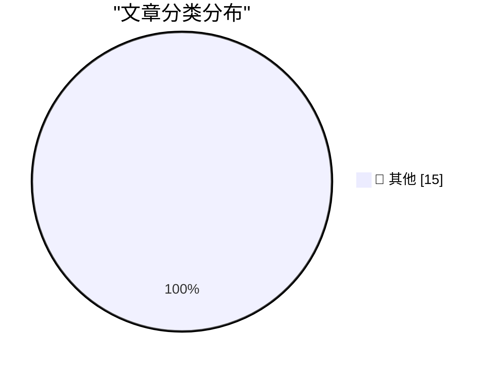

# 📰 AI 博客每日精选 — 2026-11-09

> 来自 Karpathy 推荐的 92 个顶级技术博客，AI 精选 Top 15

## 🏆 今日必读

🥇 **The Web Is More Than Enough, by Paul Ford**

[The Web Is More Than Enough, by Paul Ford](https://simonwillison.net/2026/Nov/9/hn-50421091/) — simonwillison.net · 15 小时前 · 📝 其他

> The Web Is More Than Enough, by Paul Ford

🥈 **Hide your slop PR descriptions behind 

**

[Hide your slop PR descriptions behind 

](https://simonwillison.net/2026/Nov/9/details-summary/) — simonwillison.net · 15 小时前 · 📝 其他

> Hide your slop PR descriptions behind 

🥉 **parse_number() as a SQLite extension: C vs Rust**

[parse_number() as a SQLite extension: C vs Rust](https://simonwillison.net/2026/Nov/8/sqlite-parse-number-c-vs-rust/) — simonwillison.net · 21 小时前 · 📝 其他

> parse_number() as a SQLite extension: C vs Rust

---

## 📊 数据概览

| 扫描源 | 抓取文章 | 时间范围 | 精选 |
|:---:|:---:|:---:|:---:|
| 79/92 | 2471 篇 → 26 篇 | 48h | **15 篇** |

### 分类分布

---

## 📝 其他

### 1. The Web Is More Than Enough, by Paul Ford

[The Web Is More Than Enough, by Paul Ford](https://simonwillison.net/2026/Nov/9/hn-50421091/) — **simonwillison.net** · 15 小时前 · ⭐ 15/30

> The Web Is More Than Enough, by Paul Ford

---

### 2. Hide your slop PR descriptions behind 

[Hide your slop PR descriptions behind 

](https://simonwillison.net/2026/Nov/9/details-summary/) — **simonwillison.net** · 15 小时前 · ⭐ 15/30

> Hide your slop PR descriptions behind 

---

### 3. parse_number() as a SQLite extension: C vs Rust

[parse_number() as a SQLite extension: C vs Rust](https://simonwillison.net/2026/Nov/8/sqlite-parse-number-c-vs-rust/) — **simonwillison.net** · 21 小时前 · ⭐ 15/30

> parse_number() as a SQLite extension: C vs Rust

---

### 4. datasette #3046: Don't serve link: rel=next HTTP headers to Firefox for HTML pages

[datasette #3046: Don't serve link: rel=next HTTP headers to Firefox for HTML pages](https://simonwillison.net/2026/Nov/7/link-rel-next/) — **simonwillison.net** · 1 天前 · ⭐ 15/30

> datasette #3046: Don't serve link: rel=next HTTP headers to Firefox for HTML pages

---

### 5. LLMs are terrible at designing AI systems

[LLMs are terrible at designing AI systems](https://seangoedecke.com/llms-are-terrible-at-designing-ai-systems/) — **seangoedecke.com** · 1 天前 · ⭐ 15/30

> LLMs are terrible at designing AI systems

---

### 6. Rubio Warned Officials About Nvidia Chief’s Entanglement With Chinese Spy - the New York Times

[Rubio Warned Officials About Nvidia Chief’s Entanglement With Chinese Spy - the New York Times](https://www.nytimes.com/2026/11/08/us/politics/rubio-nvidia-ceo-chinese-spy.html?unlocked_article_code=1.PFE.dLW7.D8C1YUYhNooj) — **daringfireball.net** · 2 小时前 · ⭐ 15/30

> Rubio Warned Officials About Nvidia Chief’s Entanglement With Chinese Spy - the New York Times

---

### 7. Jensen Huang Betrayed Nvidia, Not Just His Family

[Jensen Huang Betrayed Nvidia, Not Just His Family](https://www.nytimes.com/2026/11/06/us/politics/chinese-spy-agency-nvidia-jensen-huang.html?unlocked_article_code=1.O1E.DRyO.9mNcxhaxhtlI) — **daringfireball.net** · 20 小时前 · ⭐ 15/30

> Jensen Huang Betrayed Nvidia, Not Just His Family

---

### 8. Nvidia CEO Jensen Huang Was Banging a Chinese Spy, Who Was Feeding Information Back to Beijing

[Nvidia CEO Jensen Huang Was Banging a Chinese Spy, Who Was Feeding Information Back to Beijing](https://www.nytimes.com/2026/11/08/technology/nvidia-investigation-jensen-huang-china.html?unlocked_article_code=1.O1E.Soow.6UjrM7Ch-C8L) — **daringfireball.net** · 22 小时前 · ⭐ 15/30

> Nvidia CEO Jensen Huang Was Banging a Chinese Spy, Who Was Feeding Information Back to Beijing

---

### 9. Yours Truly on Full Stack Creator, Talking About the New MacBook Pros With PROLED XDR Displays

[Yours Truly on Full Stack Creator, Talking About the New MacBook Pros With PROLED XDR Displays](https://www.youtube.com/watch?v=f2GZtWuUPl0) — **daringfireball.net** · 1 天前 · ⭐ 15/30

> Yours Truly on Full Stack Creator, Talking About the New MacBook Pros With PROLED XDR Displays

---

### 10. Horible public key tricks:

[Horible public key tricks:](https://maurycyz.com/projects/badcert/) — **maurycyz.com** · 1 天前 · ⭐ 15/30

> Horible public key tricks:

---

### 11. Pluralistic: America cannot undo Trumpism (09 Nov 2026)

[Pluralistic: America cannot undo Trumpism (09 Nov 2026)](https://pluralistic.net/2026/11/09/brunch-is-canceled-forever/) — **pluralistic.net** · 12 小时前 · ⭐ 15/30

> Pluralistic: America cannot undo Trumpism (09 Nov 2026)

---

### 12. Optimal virulence and the Android lockdown

[Optimal virulence and the Android lockdown](https://dynomight.net/android/) — **dynomight.net** · 20 小时前 · ⭐ 15/30

> Optimal virulence and the Android lockdown

---

### 13. Reverse engineering a vintage diode-transistor logic chip

[Reverse engineering a vintage diode-transistor logic chip](http://www.righto.com/feeds/7533579802505281921/comments/default) — **righto.com** · 1 天前 · ⭐ 15/30

> Reverse engineering a vintage diode-transistor logic chip

---

### 14. AI and Irontown

[AI and Irontown](https://lucumr.pocoo.org/2026/11/9/irontown/) — **lucumr.pocoo.org** · 20 小时前 · ⭐ 15/30

> AI and Irontown

---

### 15. Steiner Systems

[Steiner Systems](https://www.johndcook.com/blog/2026/11/09/steiner-systems/) — **johndcook.com** · 3 小时前 · ⭐ 15/30

> Steiner Systems

---

*生成于 2026-11-09 20:14 | 扫描 79 源 → 获取 2471 篇 → 精选 15 篇*
*基于 [Hacker News Popularity Contest 2025](https://refactoringenglish.com/tools/hn-popularity/) RSS 源列表，由 [Andrej Karpathy](https://x.com/karpathy) 推荐*
*由「懂点儿AI」制作，欢迎关注同名微信公众号获取更多 AI 实用技巧 💡*
