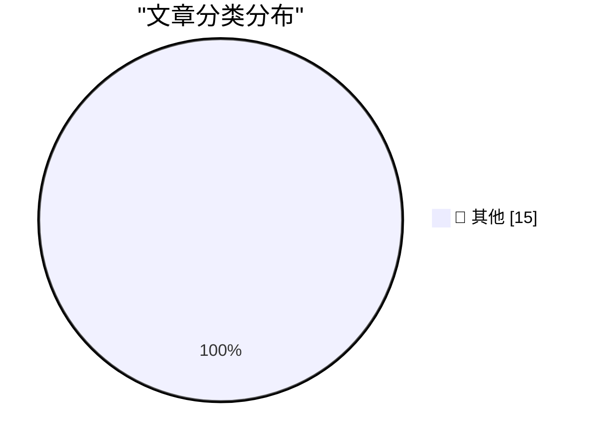

# 📰 AI 博客每日精选 — 2026-11-27

> 来自 Karpathy 推荐的 92 个顶级技术博客，AI 精选 Top 15

## 🏆 今日必读

🥇 **Quoting Jack Despain Zhou**

[Quoting Jack Despain Zhou](https://simonwillison.net/2026/Nov/26/jack-despain-zhou/) — simonwillison.net · 1 天前 · 📝 其他

> Quoting Jack Despain Zhou

🥈 **sqlite3_rsync: Database Remote-Copy Tool For SQLite**

[sqlite3_rsync: Database Remote-Copy Tool For SQLite](https://simonwillison.net/2026/Nov/26/sqlite3-rsync/) — simonwillison.net · 1 天前 · 📝 其他

> sqlite3_rsync: Database Remote-Copy Tool For SQLite

🥉 **The New York Times warns photographers not to update Photoshop over AI features**

[The New York Times warns photographers not to update Photoshop over AI features](https://simonwillison.net/2026/Nov/26/hn-50651685/) — simonwillison.net · 1 天前 · 📝 其他

> The New York Times warns photographers not to update Photoshop over AI features

---

## 📊 数据概览

| 扫描源 | 抓取文章 | 时间范围 | 精选 |
|:---:|:---:|:---:|:---:|
| 80/92 | 2473 篇 → 23 篇 | 48h | **15 篇** |

### 分类分布

---

## 📝 其他

### 1. Quoting Jack Despain Zhou

[Quoting Jack Despain Zhou](https://simonwillison.net/2026/Nov/26/jack-despain-zhou/) — **simonwillison.net** · 1 天前 · ⭐ 15/30

> Quoting Jack Despain Zhou

---

### 2. sqlite3_rsync: Database Remote-Copy Tool For SQLite

[sqlite3_rsync: Database Remote-Copy Tool For SQLite](https://simonwillison.net/2026/Nov/26/sqlite3-rsync/) — **simonwillison.net** · 1 天前 · ⭐ 15/30

> sqlite3_rsync: Database Remote-Copy Tool For SQLite

---

### 3. The New York Times warns photographers not to update Photoshop over AI features

[The New York Times warns photographers not to update Photoshop over AI features](https://simonwillison.net/2026/Nov/26/hn-50651685/) — **simonwillison.net** · 1 天前 · ⭐ 15/30

> The New York Times warns photographers not to update Photoshop over AI features

---

### 4. Quoting Scott Aaronson

[Quoting Scott Aaronson](https://simonwillison.net/2026/Nov/25/scott-aaronson/) — **simonwillison.net** · 1 天前 · ⭐ 15/30

> Quoting Scott Aaronson

---

### 5. Remotely unplugging a USB device on my Mac, without touching it

[Remotely unplugging a USB device on my Mac, without touching it](https://www.jeffgeerling.com/blog/2026/remote-control-usb-hub/) — **jeffgeerling.com** · 13 小时前 · ⭐ 15/30

> Remotely unplugging a USB device on my Mac, without touching it

---

### 6. Ansible Fails waiting for privilege escalation on Ubuntu 26

[Ansible Fails waiting for privilege escalation on Ubuntu 26](https://www.jeffgeerling.com/blog/2026/ansible-fails-become-ubuntu2604/) — **jeffgeerling.com** · 1 天前 · ⭐ 15/30

> Ansible Fails waiting for privilege escalation on Ubuntu 26

---

### 7. Who gets to decide if something is written by AI?

[Who gets to decide if something is written by AI?](https://seangoedecke.com/who-gets-to-decide-if-something-is-written-by-ai/) — **seangoedecke.com** · 19 小时前 · ⭐ 15/30

> Who gets to decide if something is written by AI?

---

### 8. ★ Obvious Affordances Are Due for a Comeback

[★ Obvious Affordances Are Due for a Comeback](https://daringfireball.net/2026/11/obvious_affordances_are_due_for_a_comeback) — **daringfireball.net** · 1 天前 · ⭐ 15/30

> ★ Obvious Affordances Are Due for a Comeback

---

### 9. Electrek Speculates on Trump’s Claim He ‘Protected’ Elon Musk After a ‘Very Tough Incident’ During His First Term

[Electrek Speculates on Trump’s Claim He ‘Protected’ Elon Musk After a ‘Very Tough Incident’ During His First Term](https://electrek.co/2026/11/24/trump-protected-elon-musk-first-term-tough-incident/) — **daringfireball.net** · 1 天前 · ⭐ 15/30

> Electrek Speculates on Trump’s Claim He ‘Protected’ Elon Musk After a ‘Very Tough Incident’ During His First Term

---

### 10. 1Password’s Backend Systems Were Compromised, Revealing Only Customer Account Metadata

[1Password’s Backend Systems Were Compromised, Revealing Only Customer Account Metadata](https://1password.com/blog/update-on-nov-2026-security-incident) — **daringfireball.net** · 1 天前 · ⭐ 15/30

> 1Password’s Backend Systems Were Compromised, Revealing Only Customer Account Metadata

---

### 11. ‘Trump Wanted Jensen Huang Back. Now, the President Is Alone in Washington’

[‘Trump Wanted Jensen Huang Back. Now, the President Is Alone in Washington’](https://www.cnbc.com/2026/11/24/trump-jensen-huang-nvidia.html) — **daringfireball.net** · 1 天前 · ⭐ 15/30

> ‘Trump Wanted Jensen Huang Back. Now, the President Is Alone in Washington’

---

### 12. Pluralistic: Taylorism and AI's shared sales-pitch (27 Nov 2026)

[Pluralistic: Taylorism and AI's shared sales-pitch (27 Nov 2026)](https://pluralistic.net/2026/11/27/taylor-made/) — **pluralistic.net** · 5 小时前 · ⭐ 15/30

> Pluralistic: Taylorism and AI's shared sales-pitch (27 Nov 2026)

---

### 13. Pluralistic: Charles Koch is a cult leader (26 Nov 2026)

[Pluralistic: Charles Koch is a cult leader (26 Nov 2026)](https://pluralistic.net/2026/11/26/science-of-liberty/) — **pluralistic.net** · 1 天前 · ⭐ 15/30

> Pluralistic: Charles Koch is a cult leader (26 Nov 2026)

---

### 14. Underrated reasons to be thankful VI

[Underrated reasons to be thankful VI](https://dynomight.net/thanks-6/) — **dynomight.net** · 1 天前 · ⭐ 15/30

> Underrated reasons to be thankful VI

---

### 15. What happens when you put a non-agile object in the CoreApplication Properties?

[What happens when you put a non-agile object in the CoreApplication Properties?](https://devblogs.microsoft.com/oldnewthing/20261126-00/?p=112899/) — **devblogs.microsoft.com/oldnewthing** · 1 天前 · ⭐ 15/30

> What happens when you put a non-agile object in the CoreApplication Properties?

---

*生成于 2026-11-27 19:13 | 扫描 80 源 → 获取 2473 篇 → 精选 15 篇*
*基于 [Hacker News Popularity Contest 2025](https://refactoringenglish.com/tools/hn-popularity/) RSS 源列表，由 [Andrej Karpathy](https://x.com/karpathy) 推荐*
*由「懂点儿AI」制作，欢迎关注同名微信公众号获取更多 AI 实用技巧 💡*
