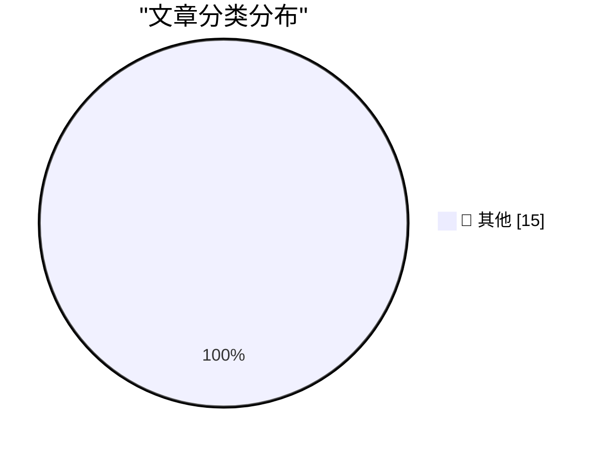

# 📰 AI 博客每日精选 — 2026-11-24

> 来自 Karpathy 推荐的 92 个顶级技术博客，AI 精选 Top 15

## 🏆 今日必读

🥇 **GPT 6.2 Astra Solves a Historical Mystery**

[GPT 6.2 Astra Solves a Historical Mystery](https://simonwillison.net/2026/Nov/24/astra-historical-mystery/) — simonwillison.net · 3 小时前 · 📝 其他

> GPT 6.2 Astra Solves a Historical Mystery

🥈 **datasette-charts 0.2a0**

[datasette-charts 0.2a0](https://simonwillison.net/2026/Nov/24/datasette-charts/) — simonwillison.net · 15 小时前 · 📝 其他

> datasette-charts 0.2a0

🥉 **datasette-agent 0.7a1**

[datasette-agent 0.7a1](https://simonwillison.net/2026/Nov/24/datasette-agent/) — simonwillison.net · 16 小时前 · 📝 其他

> datasette-agent 0.7a1

---

## 📊 数据概览

| 扫描源 | 抓取文章 | 时间范围 | 精选 |
|:---:|:---:|:---:|:---:|
| 82/92 | 2500 篇 → 47 篇 | 48h | **15 篇** |

### 分类分布

---

## 📝 其他

### 1. GPT 6.2 Astra Solves a Historical Mystery

[GPT 6.2 Astra Solves a Historical Mystery](https://simonwillison.net/2026/Nov/24/astra-historical-mystery/) — **simonwillison.net** · 3 小时前 · ⭐ 15/30

> GPT 6.2 Astra Solves a Historical Mystery

---

### 2. datasette-charts 0.2a0

[datasette-charts 0.2a0](https://simonwillison.net/2026/Nov/24/datasette-charts/) — **simonwillison.net** · 15 小时前 · ⭐ 15/30

> datasette-charts 0.2a0

---

### 3. datasette-agent 0.7a1

[datasette-agent 0.7a1](https://simonwillison.net/2026/Nov/24/datasette-agent/) — **simonwillison.net** · 16 小时前 · ⭐ 15/30

> datasette-agent 0.7a1

---

### 4. GLM-5.4: Toward Generalized Coding with Our First Loop Transformer

[GLM-5.4: Toward Generalized Coding with Our First Loop Transformer](https://simonwillison.net/2026/Nov/23/glm-54/) — **simonwillison.net** · 20 小时前 · ⭐ 15/30

> GLM-5.4: Toward Generalized Coding with Our First Loop Transformer

---

### 5. Ladybird's first alpha release

[Ladybird's first alpha release](https://simonwillison.net/2026/Nov/23/ladybird/) — **simonwillison.net** · 22 小时前 · ⭐ 15/30

> Ladybird's first alpha release

---

### 6. datasette-charts 0.1a0

[datasette-charts 0.1a0](https://simonwillison.net/2026/Nov/23/datasette-charts/) — **simonwillison.net** · 1 天前 · ⭐ 15/30

> datasette-charts 0.1a0

---

### 7. When in doubt, flail about

[When in doubt, flail about](https://seangoedecke.com/when-in-doubt-flail-about/) — **seangoedecke.com** · 1 天前 · ⭐ 15/30

> When in doubt, flail about

---

### 8. Notes on OpenAI's perplexity reveal

[Notes on OpenAI's perplexity reveal](https://seangoedecke.com/notes-on-openais-perplexity-reveal/) — **seangoedecke.com** · 1 天前 · ⭐ 15/30

> Notes on OpenAI's perplexity reveal

---

### 9. ‘The Economy Is a Hostage Situation’

[‘The Economy Is a Hostage Situation’](https://www.theatlantic.com/technology/2026/11/ai-hostage-economy-nvidia-huang/689552/?gift=aQyUJR7AIw1mJWdQ6Ed6yMQrokNaYAmgr0aVusAzQCY&amp;) — **daringfireball.net** · 1 小时前 · ⭐ 15/30

> ‘The Economy Is a Hostage Situation’

---

### 10. I Told You to Bet the Over

[I Told You to Bet the Over](https://www.wsj.com/business/nvidia-jensen-huang-white-house-9ad03961?st=HzeUyV) — **daringfireball.net** · 1 小时前 · ⭐ 15/30

> I Told You to Bet the Over

---

### 11. Restoring a 1982 ‘Star Wars’ Poster From Japan

[Restoring a 1982 ‘Star Wars’ Poster From Japan](https://www.instagram.com/p/DcUk0WjBwVI/) — **daringfireball.net** · 2 小时前 · ⭐ 15/30

> Restoring a 1982 ‘Star Wars’ Poster From Japan

---

### 12. Enron Employees Give Kenneth Lay a Standing Ovation Upon His Return as CEO in 2001

[Enron Employees Give Kenneth Lay a Standing Ovation Upon His Return as CEO in 2001](https://www.threads.com/@meidastouch/post/DgGKhbTAka5) — **daringfireball.net** · 3 小时前 · ⭐ 15/30

> Enron Employees Give Kenneth Lay a Standing Ovation Upon His Return as CEO in 2001

---

### 13. David Sacks’s Pool Boy Is Cocky

[David Sacks’s Pool Boy Is Cocky](https://www.threads.com/@karaswisher/post/DgGBe_XI147) — **daringfireball.net** · 3 小时前 · ⭐ 15/30

> David Sacks’s Pool Boy Is Cocky

---

### 14. Jason Zengerle Profiles Treasury Secretary Scott Bessent for The New Yorker

[Jason Zengerle Profiles Treasury Secretary Scott Bessent for The New Yorker](https://www.newyorker.com/magazine/2026/11/30/scott-bessent-profile) — **daringfireball.net** · 4 小时前 · ⭐ 15/30

> Jason Zengerle Profiles Treasury Secretary Scott Bessent for The New Yorker

---

### 15. [Sponsor] Finalist Daily Planner Meets iPhone Duo

[[Sponsor] Finalist Daily Planner Meets iPhone Duo](https://www.finalist.works/iphone-duo-planner/?utm_source=df-nov-2026) — **daringfireball.net** · 20 小时前 · ⭐ 15/30

> [Sponsor] Finalist Daily Planner Meets iPhone Duo

---

*生成于 2026-11-24 20:24 | 扫描 82 源 → 获取 2500 篇 → 精选 15 篇*
*基于 [Hacker News Popularity Contest 2025](https://refactoringenglish.com/tools/hn-popularity/) RSS 源列表，由 [Andrej Karpathy](https://x.com/karpathy) 推荐*
*由「懂点儿AI」制作，欢迎关注同名微信公众号获取更多 AI 实用技巧 💡*
