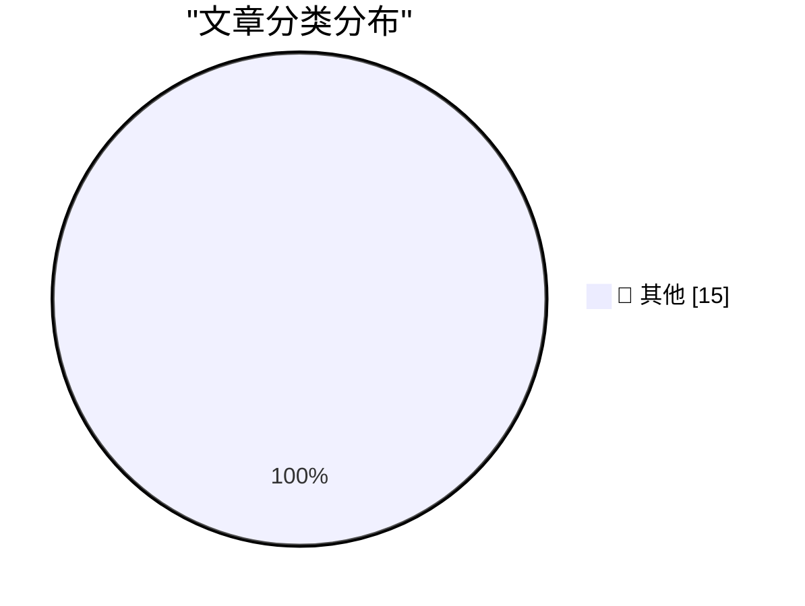

# 📰 AI 博客每日精选 — 2026-10-12

> 来自 Karpathy 推荐的 92 个顶级技术博客，AI 精选 Top 15

## 🏆 今日必读

🥇 **Hello Python 3.15, goodbye 3.10, and now I can use 3.11**

[Hello Python 3.15, goodbye 3.10, and now I can use 3.11](https://simonwillison.net/2026/Oct/12/python-3-15/) — simonwillison.net · 1 小时前 · 📝 其他

> Hello Python 3.15, goodbye 3.10, and now I can use 3.11

🥈 **datasette-ports 0.4**

[datasette-ports 0.4](https://simonwillison.net/2026/Oct/12/datasette-ports/) — simonwillison.net · 14 小时前 · 📝 其他

> datasette-ports 0.4

🥉 **Dwarf Fortress uses version control now**

[Dwarf Fortress uses version control now](https://simonwillison.net/2026/Oct/11/dwarf-fortress/) — simonwillison.net · 1 天前 · 📝 其他

> Dwarf Fortress uses version control now

---

## 📊 数据概览

| 扫描源 | 抓取文章 | 时间范围 | 精选 |
|:---:|:---:|:---:|:---:|
| 83/92 | 2532 篇 → 21 篇 | 48h | **15 篇** |

### 分类分布

---

## 📝 其他

### 1. Hello Python 3.15, goodbye 3.10, and now I can use 3.11

[Hello Python 3.15, goodbye 3.10, and now I can use 3.11](https://simonwillison.net/2026/Oct/12/python-3-15/) — **simonwillison.net** · 1 小时前 · ⭐ 15/30

> Hello Python 3.15, goodbye 3.10, and now I can use 3.11

---

### 2. datasette-ports 0.4

[datasette-ports 0.4](https://simonwillison.net/2026/Oct/12/datasette-ports/) — **simonwillison.net** · 14 小时前 · ⭐ 15/30

> datasette-ports 0.4

---

### 3. Dwarf Fortress uses version control now

[Dwarf Fortress uses version control now](https://simonwillison.net/2026/Oct/11/dwarf-fortress/) — **simonwillison.net** · 1 天前 · ⭐ 15/30

> Dwarf Fortress uses version control now

---

### 4. Python 3.15.0 added to actions/python-versions

[Python 3.15.0 added to actions/python-versions](https://simonwillison.net/2026/Oct/10/python-actions/) — **simonwillison.net** · 1 天前 · ⭐ 15/30

> Python 3.15.0 added to actions/python-versions

---

### 5. Software engineers don't get to be Luddites about AI

[Software engineers don't get to be Luddites about AI](https://seangoedecke.com/software-engineers-dont-get-to-be-luddites-about-ai/) — **seangoedecke.com** · 19 小时前 · ⭐ 15/30

> Software engineers don't get to be Luddites about AI

---

### 6. Don't diagnose your opponents

[Don't diagnose your opponents](https://seangoedecke.com/dont-diagnose-your-opponents/) — **seangoedecke.com** · 1 天前 · ⭐ 15/30

> Don't diagnose your opponents

---

### 7. Mark Stephens, a.k.a. Robert X. Cringely, Died at 73

[Mark Stephens, a.k.a. Robert X. Cringely, Died at 73](https://www.facebook.com/story.php?story_fbid=pfbid0YbCLrAJfBirAWuPBy4a7pauaQ6gHkAPUwtbzyg2wAjeMcruFC7dWUZKQJKkNChP9l&amp;id=536506060&amp;_rdr) — **daringfireball.net** · 2 小时前 · ⭐ 15/30

> Mark Stephens, a.k.a. Robert X. Cringely, Died at 73

---

### 8. ★ X Once Again Marks the Spot

[★ X Once Again Marks the Spot](https://daringfireball.net/2026/10/x_once_again_marks_the_spot) — **daringfireball.net** · 22 小时前 · ⭐ 15/30

> ★ X Once Again Marks the Spot

---

### 9. Apple Only Started Suggesting iOS 26 Users Upgrade to 27 Three Days Ago

[Apple Only Started Suggesting iOS 26 Users Upgrade to 27 Three Days Ago](https://www.macrumors.com/2026/10/08/apple-now-pushing-ios-27/) — **daringfireball.net** · 1 天前 · ⭐ 15/30

> Apple Only Started Suggesting iOS 26 Users Upgrade to 27 Three Days Ago

---

### 10. Why I Get Bored

[Why I Get Bored](https://idiallo.com/byte-size/why-i-get-bored) — **idiallo.com** · 1 天前 · ⭐ 15/30

> Why I Get Bored

---

### 11. Pluralistic: How labor rights rescued Ultima from a monopolist (12 Oct 2026)

[Pluralistic: How labor rights rescued Ultima from a monopolist (12 Oct 2026)](https://pluralistic.net/2026/10/12/termination-of-transfer/) — **pluralistic.net** · 7 小时前 · ⭐ 15/30

> Pluralistic: How labor rights rescued Ultima from a monopolist (12 Oct 2026)

---

### 12. I paid people to try and follow my README

[I paid people to try and follow my README](https://shkspr.mobi/blog/2026/10/i-paid-people-to-try-and-follow-my-readme/) — **shkspr.mobi** · 1 天前 · ⭐ 15/30

> I paid people to try and follow my README

---

### 13. Categorical models of logics

[Categorical models of logics](https://www.johndcook.com/blog/2026/10/12/categorical-models-of-logics/) — **johndcook.com** · 6 小时前 · ⭐ 15/30

> Categorical models of logics

---

### 14. Just say no to OpenAI and Anthropic

[Just say no to OpenAI and Anthropic](https://micahflee.com/just-say-no-to-openai-and-anthropic/) — **micahflee.com** · 20 小时前 · ⭐ 15/30

> Just say no to OpenAI and Anthropic

---

### 15. Now That’s What I Call Technical Debt!

[Now That’s What I Call Technical Debt!](https://nesbitt.io/2026/10/12/now-thats-what-i-call-technical-debt.html) — **nesbitt.io** · 10 小时前 · ⭐ 15/30

> Now That’s What I Call Technical Debt!

---

*生成于 2026-10-12 19:27 | 扫描 83 源 → 获取 2532 篇 → 精选 15 篇*
*基于 [Hacker News Popularity Contest 2025](https://refactoringenglish.com/tools/hn-popularity/) RSS 源列表，由 [Andrej Karpathy](https://x.com/karpathy) 推荐*
*由「懂点儿AI」制作，欢迎关注同名微信公众号获取更多 AI 实用技巧 💡*
