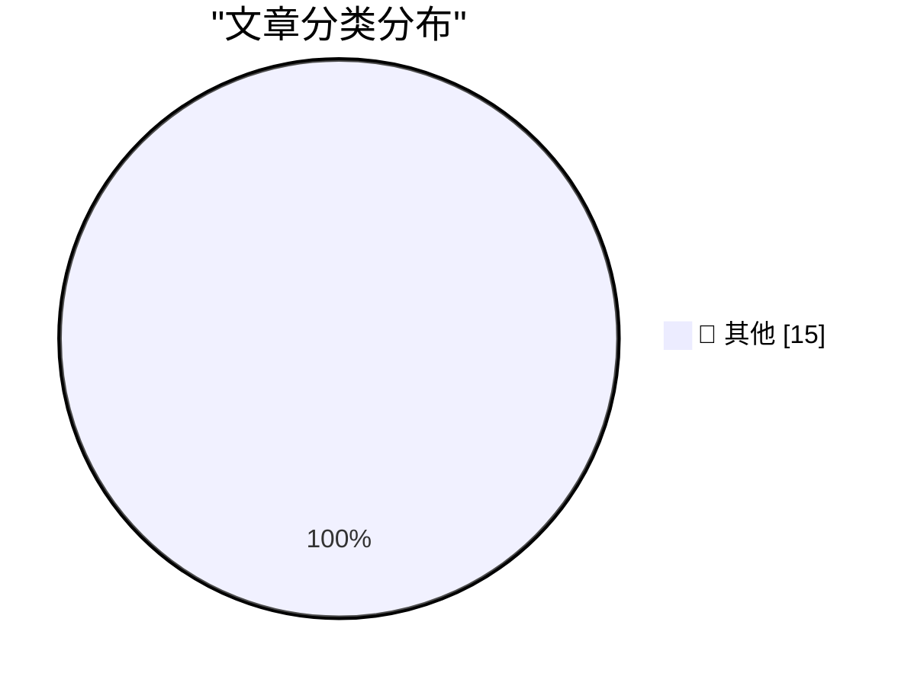

# 📰 AI 博客每日精选 — 2026-11-10

> 来自 Karpathy 推荐的 92 个顶级技术博客，AI 精选 Top 15

## 🏆 今日必读

🥇 **Introducing Our Smallest, Most Efficient Model: Muse Ember**

[Introducing Our Smallest, Most Efficient Model: Muse Ember](https://simonwillison.net/2026/Nov/10/muse-ember/) — simonwillison.net · 9 小时前 · 📝 其他

> Introducing Our Smallest, Most Efficient Model: Muse Ember

🥈 **Quoting Prompting Claude Fable 5.2**

[Quoting Prompting Claude Fable 5.2](https://simonwillison.net/2026/Nov/10/prompting-claude-fable-52/) — simonwillison.net · 11 小时前 · 📝 其他

> Quoting Prompting Claude Fable 5.2

🥉 **Yonkers Rises**

[Yonkers Rises](https://simonwillison.net/2026/Nov/10/yonkers-rises/) — simonwillison.net · 13 小时前 · 📝 其他

> Yonkers Rises

---

## 📊 数据概览

| 扫描源 | 抓取文章 | 时间范围 | 精选 |
|:---:|:---:|:---:|:---:|
| 82/92 | 2544 篇 → 45 篇 | 48h | **15 篇** |

### 分类分布

---

## 📝 其他

### 1. Introducing Our Smallest, Most Efficient Model: Muse Ember

[Introducing Our Smallest, Most Efficient Model: Muse Ember](https://simonwillison.net/2026/Nov/10/muse-ember/) — **simonwillison.net** · 9 小时前 · ⭐ 15/30

> Introducing Our Smallest, Most Efficient Model: Muse Ember

---

### 2. Quoting Prompting Claude Fable 5.2

[Quoting Prompting Claude Fable 5.2](https://simonwillison.net/2026/Nov/10/prompting-claude-fable-52/) — **simonwillison.net** · 11 小时前 · ⭐ 15/30

> Quoting Prompting Claude Fable 5.2

---

### 3. Yonkers Rises

[Yonkers Rises](https://simonwillison.net/2026/Nov/10/yonkers-rises/) — **simonwillison.net** · 13 小时前 · ⭐ 15/30

> Yonkers Rises

---

### 4. llm-anthropic 0.31

[llm-anthropic 0.31](https://simonwillison.net/2026/Nov/9/llm-anthropic/) — **simonwillison.net** · 17 小时前 · ⭐ 15/30

> llm-anthropic 0.31

---

### 5. Locating the source of a mysterious beep with Claude

[Locating the source of a mysterious beep with Claude](https://simonwillison.net/2026/Nov/9/mysterious-beeps/) — **simonwillison.net** · 17 小时前 · ⭐ 15/30

> Locating the source of a mysterious beep with Claude

---

### 6. The Web Is More Than Enough, by Paul Ford

[The Web Is More Than Enough, by Paul Ford](https://simonwillison.net/2026/Nov/9/hn-50421091/) — **simonwillison.net** · 1 天前 · ⭐ 15/30

> The Web Is More Than Enough, by Paul Ford

---

### 7. Hide your slop PR descriptions behind 

[Hide your slop PR descriptions behind 

](https://simonwillison.net/2026/Nov/9/details-summary/) — **simonwillison.net** · 1 天前 · ⭐ 15/30

> Hide your slop PR descriptions behind 

---

### 8. parse_number() as a SQLite extension: C vs Rust

[parse_number() as a SQLite extension: C vs Rust](https://simonwillison.net/2026/Nov/8/sqlite-parse-number-c-vs-rust/) — **simonwillison.net** · 1 天前 · ⭐ 15/30

> parse_number() as a SQLite extension: C vs Rust

---

### 9. Bloomberg: ‘Nvidia Intervened in U.S. Probe of Megaspeed Chip Smuggling’

[Bloomberg: ‘Nvidia Intervened in U.S. Probe of Megaspeed Chip Smuggling’](https://www.bloomberg.com/news/articles/2026-11-09/nvidia-intervened-in-us-probe-of-megaspeed-chip-smuggling) — **daringfireball.net** · 14 分钟前 · ⭐ 15/30

> Bloomberg: ‘Nvidia Intervened in U.S. Probe of Megaspeed Chip Smuggling’

---

### 10. Regarding Graveyards and Indispensable Men

[Regarding Graveyards and Indispensable Men](https://www.youtube.com/watch?v=vydmUCGQnyI) — **daringfireball.net** · 19 分钟前 · ⭐ 15/30

> Regarding Graveyards and Indispensable Men

---

### 11. Steven Levy on John Ternus

[Steven Levy on John Ternus](https://www.wired.com/story/i-spent-30-minutes-with-apples-ceo-now-i-know-why-john-ternus-got-the-job/) — **daringfireball.net** · 48 分钟前 · ⭐ 15/30

> Steven Levy on John Ternus

---

### 12. OurCal

[OurCal](https://ourcal.com/?utm_source=daringfireball&amp;utm_medium=sponsorship&amp;utm_content=post-thankyou) — **daringfireball.net** · 2 小时前 · ⭐ 15/30

> OurCal

---

### 13. Safari 27.3 Adds Support for Global Privacy Control

[Safari 27.3 Adds Support for Global Privacy Control](https://pxlnv.com/linklog/safari-global-privacy-control/) — **daringfireball.net** · 2 小时前 · ⭐ 15/30

> Safari 27.3 Adds Support for Global Privacy Control

---

### 14. ‘A Scandal at the Center of the Economy’

[‘A Scandal at the Center of the Economy’](https://www.theatlantic.com/technology/2026/11/jensen-huang-chinese-spy/689357/?gift=aQyUJR7AIw1mJWdQ6Ed6yPI8n1FlV88MR9f9IZruvFA&amp;) — **daringfireball.net** · 2 小时前 · ⭐ 15/30

> ‘A Scandal at the Center of the Economy’

---

### 15. U.S. Commerce Dept. Inquiry Into Megaspeed Was Halted After Nvidia Name-Dropped Trump Appointee

[U.S. Commerce Dept. Inquiry Into Megaspeed Was Halted After Nvidia Name-Dropped Trump Appointee](https://www.nytimes.com/2026/11/09/business/economy/nvidia-megaspeed-investigation-huang.html?unlocked_article_code=1.PVE.GxBL.iBpBoc8Y4tnb) — **daringfireball.net** · 2 小时前 · ⭐ 15/30

> U.S. Commerce Dept. Inquiry Into Megaspeed Was Halted After Nvidia Name-Dropped Trump Appointee

---

*生成于 2026-11-10 17:20 | 扫描 82 源 → 获取 2544 篇 → 精选 15 篇*
*基于 [Hacker News Popularity Contest 2025](https://refactoringenglish.com/tools/hn-popularity/) RSS 源列表，由 [Andrej Karpathy](https://x.com/karpathy) 推荐*
*由「懂点儿AI」制作，欢迎关注同名微信公众号获取更多 AI 实用技巧 💡*
