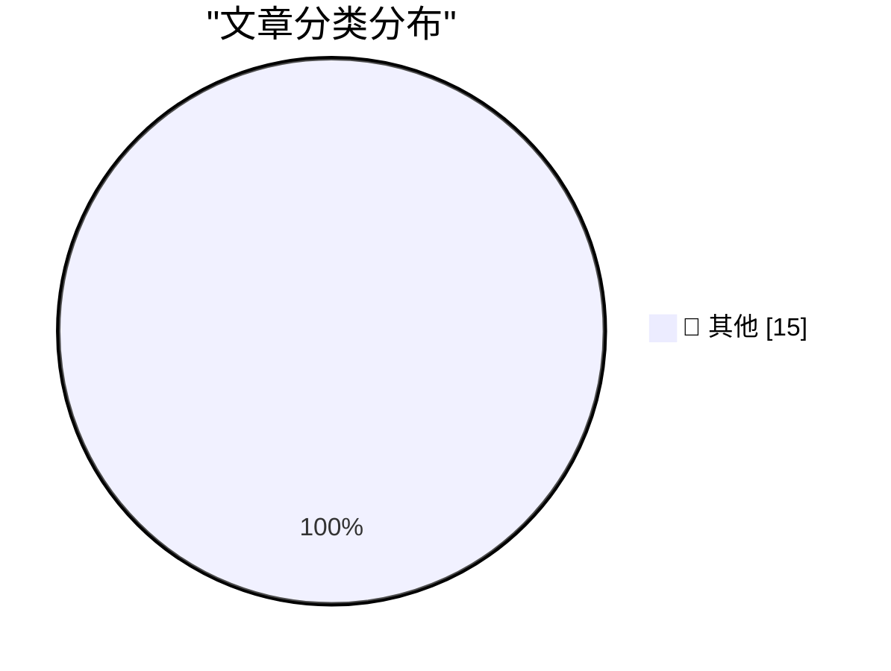

# 📰 AI 博客每日精选 — 2026-10-15

> 来自 Karpathy 推荐的 92 个顶级技术博客，AI 精选 Top 15

## 🏆 今日必读

🥇 **Anthropic tells investors quarterly revenue up nearly 50% to $16.8bn ahead of IPO**

[Anthropic tells investors quarterly revenue up nearly 50% to $16.8bn ahead of IPO](https://simonwillison.net/2026/Oct/15/anthropic-tells-investors/) — simonwillison.net · 1 小时前 · 📝 其他

> Anthropic tells investors quarterly revenue up nearly 50% to $16.8bn ahead of IPO

🥈 **Tree Appreciator**

[Tree Appreciator](https://simonwillison.net/2026/Oct/14/tree-appreciator/) — simonwillison.net · 17 小时前 · 📝 其他

> Tree Appreciator

🥉 **AI is mass decompiling games. That's both awesome and scary.**

[AI is mass decompiling games. That's both awesome and scary.](https://simonwillison.net/2026/Oct/14/ai-is-mass-decompiling-games/) — simonwillison.net · 22 小时前 · 📝 其他

> AI is mass decompiling games. That's both awesome and scary.

---

## 📊 数据概览

| 扫描源 | 抓取文章 | 时间范围 | 精选 |
|:---:|:---:|:---:|:---:|
| 82/92 | 2508 篇 → 23 篇 | 48h | **15 篇** |

### 分类分布

---

## 📝 其他

### 1. Anthropic tells investors quarterly revenue up nearly 50% to $16.8bn ahead of IPO

[Anthropic tells investors quarterly revenue up nearly 50% to $16.8bn ahead of IPO](https://simonwillison.net/2026/Oct/15/anthropic-tells-investors/) — **simonwillison.net** · 1 小时前 · ⭐ 15/30

> Anthropic tells investors quarterly revenue up nearly 50% to $16.8bn ahead of IPO

---

### 2. Tree Appreciator

[Tree Appreciator](https://simonwillison.net/2026/Oct/14/tree-appreciator/) — **simonwillison.net** · 17 小时前 · ⭐ 15/30

> Tree Appreciator

---

### 3. AI is mass decompiling games. That's both awesome and scary.

[AI is mass decompiling games. That's both awesome and scary.](https://simonwillison.net/2026/Oct/14/ai-is-mass-decompiling-games/) — **simonwillison.net** · 22 小时前 · ⭐ 15/30

> AI is mass decompiling games. That's both awesome and scary.

---

### 4. Redesigning source control at Anthropic

[Redesigning source control at Anthropic](https://simonwillison.net/2026/Oct/13/redesigning-source-control-at-anthropic/) — **simonwillison.net** · 1 天前 · ⭐ 15/30

> Redesigning source control at Anthropic

---

### 5. llm-gemini 0.35

[llm-gemini 0.35](https://simonwillison.net/2026/Oct/13/llm-gemini/) — **simonwillison.net** · 1 天前 · ⭐ 15/30

> llm-gemini 0.35

---

### 6. Formlabs dropped the Raspberry Pi on the way to a $699 SLA printer

[Formlabs dropped the Raspberry Pi on the way to a $699 SLA printer](https://www.jeffgeerling.com/blog/2026/formlabs-form-studio-1-resin-printer/) — **jeffgeerling.com** · 1 天前 · ⭐ 15/30

> Formlabs dropped the Raspberry Pi on the way to a $699 SLA printer

---

### 7. U.K. Sanctions Cryptomus for RU Money Laundering

[U.K. Sanctions Cryptomus for RU Money Laundering](https://krebsonsecurity.com/2026/10/u-k-sanctions-cryptomus-for-ru-money-laundering/) — **krebsonsecurity.com** · 1 天前 · ⭐ 15/30

> U.K. Sanctions Cryptomus for RU Money Laundering

---

### 8. Microsoft Patches More Than 1,400 Security Flaws

[Microsoft Patches More Than 1,400 Security Flaws](https://krebsonsecurity.com/2026/10/microsoft-patches-more-than-1400-security-flaws/) — **krebsonsecurity.com** · 1 天前 · ⭐ 15/30

> Microsoft Patches More Than 1,400 Security Flaws

---

### 9. [Sponsor] WorkOS AuthKit: Auth for Your App, Free Up to 1M Monthly Active Users

[[Sponsor] WorkOS AuthKit: Auth for Your App, Free Up to 1M Monthly Active Users](https://workos.com/?utm_source=daringfireball&amp;utm_medium=newsletter&amp;utm_campaign=q42026) — **daringfireball.net** · 17 小时前 · ⭐ 15/30

> [Sponsor] WorkOS AuthKit: Auth for Your App, Free Up to 1M Monthly Active Users

---

### 10. The FBI Arrested a Saudi National OpenAI Employee for Planting a Recording Device in the Company’s Executive Conference Room

[The FBI Arrested a Saudi National OpenAI Employee for Planting a Recording Device in the Company’s Executive Conference Room](https://www.justice.gov/opa/pr/saudi-national-arrested-installing-surreptitious-audio-recording-device-openai) — **daringfireball.net** · 17 小时前 · ⭐ 15/30

> The FBI Arrested a Saudi National OpenAI Employee for Planting a Recording Device in the Company’s Executive Conference Room

---

### 11. Apple HomeView

[Apple HomeView](https://www.apple.com/newsroom/2026/10/meet-apple-homeview-a-new-way-to-enjoy-entertainment-and-manage-the-home/) — **daringfireball.net** · 1 天前 · ⭐ 15/30

> Apple HomeView

---

### 12. Pluralistic: Expedia amazoned hotel rooms (15 Oct 2026)

[Pluralistic: Expedia amazoned hotel rooms (15 Oct 2026)](https://pluralistic.net/2026/10/15/enshittipedia/) — **pluralistic.net** · 3 小时前 · ⭐ 15/30

> Pluralistic: Expedia amazoned hotel rooms (15 Oct 2026)

---

### 13. The Internet of Very Cheap Things

[The Internet of Very Cheap Things](https://shkspr.mobi/blog/2026/10/the-internet-of-very-cheap-things/) — **shkspr.mobi** · 1 天前 · ⭐ 15/30

> The Internet of Very Cheap Things

---

### 14. "No way to prevent this" say users of only language where this regularly happens

["No way to prevent this" say users of only language where this regularly happens](https://xeiaso.net/shitposts/no-way-to-prevent-this/memory-safety/CVE-2026-92392/) — **xeiaso.net** · 1 天前 · ⭐ 15/30

> "No way to prevent this" say users of only language where this regularly happens

---

### 15. LaTeX package for Pascal-like triangles

[LaTeX package for Pascal-like triangles](https://www.johndcook.com/blog/2026/10/14/latex-package-for-pascal-like-triangles/) — **johndcook.com** · 20 小时前 · ⭐ 15/30

> LaTeX package for Pascal-like triangles

---

*生成于 2026-10-15 14:30 | 扫描 82 源 → 获取 2508 篇 → 精选 15 篇*
*基于 [Hacker News Popularity Contest 2025](https://refactoringenglish.com/tools/hn-popularity/) RSS 源列表，由 [Andrej Karpathy](https://x.com/karpathy) 推荐*
*由「懂点儿AI」制作，欢迎关注同名微信公众号获取更多 AI 实用技巧 💡*
