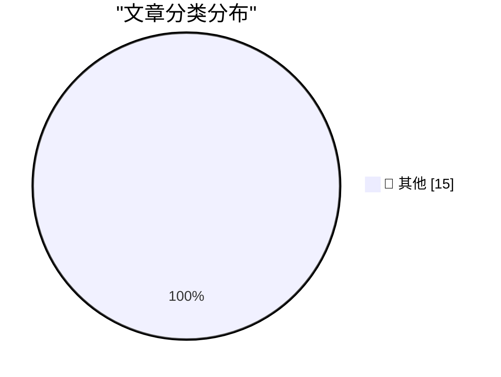

# 📰 AI 博客每日精选 — 2026-10-29

> 来自 Karpathy 推荐的 92 个顶级技术博客，AI 精选 Top 15

## 🏆 今日必读

🥇 **Quoting Ben Hylak**

[Quoting Ben Hylak](https://simonwillison.net/2026/Oct/29/ben-hylak/) — simonwillison.net · 2 小时前 · 📝 其他

> Quoting Ben Hylak

🥈 **Quoting Ted Sanders**

[Quoting Ted Sanders](https://simonwillison.net/2026/Oct/28/ted-sanders/) — simonwillison.net · 17 小时前 · 📝 其他

> Quoting Ted Sanders

🥉 **GitHub Octoverse 2026**

[GitHub Octoverse 2026](https://simonwillison.net/2026/Oct/28/github-octoverse-2026/) — simonwillison.net · 23 小时前 · 📝 其他

> GitHub Octoverse 2026

---

## 📊 数据概览

| 扫描源 | 抓取文章 | 时间范围 | 精选 |
|:---:|:---:|:---:|:---:|
| 82/92 | 2509 篇 → 29 篇 | 48h | **15 篇** |

### 分类分布

---

## 📝 其他

### 1. Quoting Ben Hylak

[Quoting Ben Hylak](https://simonwillison.net/2026/Oct/29/ben-hylak/) — **simonwillison.net** · 2 小时前 · ⭐ 15/30

> Quoting Ben Hylak

---

### 2. Quoting Ted Sanders

[Quoting Ted Sanders](https://simonwillison.net/2026/Oct/28/ted-sanders/) — **simonwillison.net** · 17 小时前 · ⭐ 15/30

> Quoting Ted Sanders

---

### 3. GitHub Octoverse 2026

[GitHub Octoverse 2026](https://simonwillison.net/2026/Oct/28/github-octoverse-2026/) — **simonwillison.net** · 23 小时前 · ⭐ 15/30

> GitHub Octoverse 2026

---

### 4. The October inflection point for vibe game development

[The October inflection point for vibe game development](https://simonwillison.net/2026/Oct/28/vibe-game-development/) — **simonwillison.net** · 1 天前 · ⭐ 15/30

> The October inflection point for vibe game development

---

### 5. Quoting Terk Terkowitz

[Quoting Terk Terkowitz](https://simonwillison.net/2026/Oct/28/terk-terkowitz/) — **simonwillison.net** · 1 天前 · ⭐ 15/30

> Quoting Terk Terkowitz

---

### 6. Game Boy Color on My Conference Badge

[Game Boy Color on My Conference Badge](https://simonwillison.net/2026/Oct/27/game-boy-color-on-my-conference-badge/) — **simonwillison.net** · 1 天前 · ⭐ 15/30

> Game Boy Color on My Conference Badge

---

### 7. Noctua Fan Swap on a Calnex Rb/GPS Frequency Reference

[Noctua Fan Swap on a Calnex Rb/GPS Frequency Reference](https://www.jeffgeerling.com/blog/2026/noctua-fan-swap-calnex-rb-gps-frequency-reference/) — **jeffgeerling.com** · 1 天前 · ⭐ 15/30

> Noctua Fan Swap on a Calnex Rb/GPS Frequency Reference

---

### 8. You can just ask AI to do things

[You can just ask AI to do things](https://seangoedecke.com/you-can-just-ask-ai-to-do-things/) — **seangoedecke.com** · 16 小时前 · ⭐ 15/30

> You can just ask AI to do things

---

### 9. Getting good at AI takes time and practice

[Getting good at AI takes time and practice](https://seangoedecke.com/getting-good-at-ai-takes-time-and-practice/) — **seangoedecke.com** · 1 天前 · ⭐ 15/30

> Getting good at AI takes time and practice

---

### 10. The Space Shuttle Discovery’s Starboard Side ‘s’ Is Upside Down

[The Space Shuttle Discovery’s Starboard Side ‘s’ Is Upside Down](https://www.theautopian.com/a-typography-geek-pointed-out-something-about-the-space-shuttle-discovery-and-now-i-cant-unsee-it/) — **daringfireball.net** · 1 小时前 · ⭐ 15/30

> The Space Shuttle Discovery’s Starboard Side ‘s’ Is Upside Down

---

### 11. Steven Levy on the New MacBook Pro, With, Yes, a Touchscreen

[Steven Levy on the New MacBook Pro, With, Yes, a Touchscreen](https://www.wired.com/story/the-inside-story-of-why-apple-finally-brought-a-touch-display-to-the-mac/) — **daringfireball.net** · 12 小时前 · ⭐ 15/30

> Steven Levy on the New MacBook Pro, With, Yes, a Touchscreen

---

### 12. Guessing the Name: MacBook Studio?

[Guessing the Name: MacBook Studio?](https://www.macrumors.com/2026/10/28/macbook-studio/) — **daringfireball.net** · 1 天前 · ⭐ 15/30

> Guessing the Name: MacBook Studio?

---

### 13. Siri AI Expands to More Languages in OS 27.2

[Siri AI Expands to More Languages in OS 27.2](https://nr.apple.com/Du9G9W8Nq1) — **daringfireball.net** · 1 天前 · ⭐ 15/30

> Siri AI Expands to More Languages in OS 27.2

---

### 14. Apple Creator Studio Updated With a Slew of AI Features, Along With a New Open JSON File Format for Keynote

[Apple Creator Studio Updated With a Slew of AI Features, Along With a New Open JSON File Format for Keynote](https://www.apple.com/newsroom/2026/10/apple-creator-studio-adds-powerful-new-ai-features-and-even-more-creative-tools/) — **daringfireball.net** · 1 天前 · ⭐ 15/30

> Apple Creator Studio Updated With a Slew of AI Features, Along With a New Open JSON File Format for Keynote

---

### 15. ★ Prestructured WYSIWYG

[★ Prestructured WYSIWYG](https://daringfireball.net/2026/10/prestructured_wysiwyg) — **daringfireball.net** · 1 天前 · ⭐ 15/30

> ★ Prestructured WYSIWYG

---

*生成于 2026-10-29 16:29 | 扫描 82 源 → 获取 2509 篇 → 精选 15 篇*
*基于 [Hacker News Popularity Contest 2025](https://refactoringenglish.com/tools/hn-popularity/) RSS 源列表，由 [Andrej Karpathy](https://x.com/karpathy) 推荐*
*由「懂点儿AI」制作，欢迎关注同名微信公众号获取更多 AI 实用技巧 💡*
