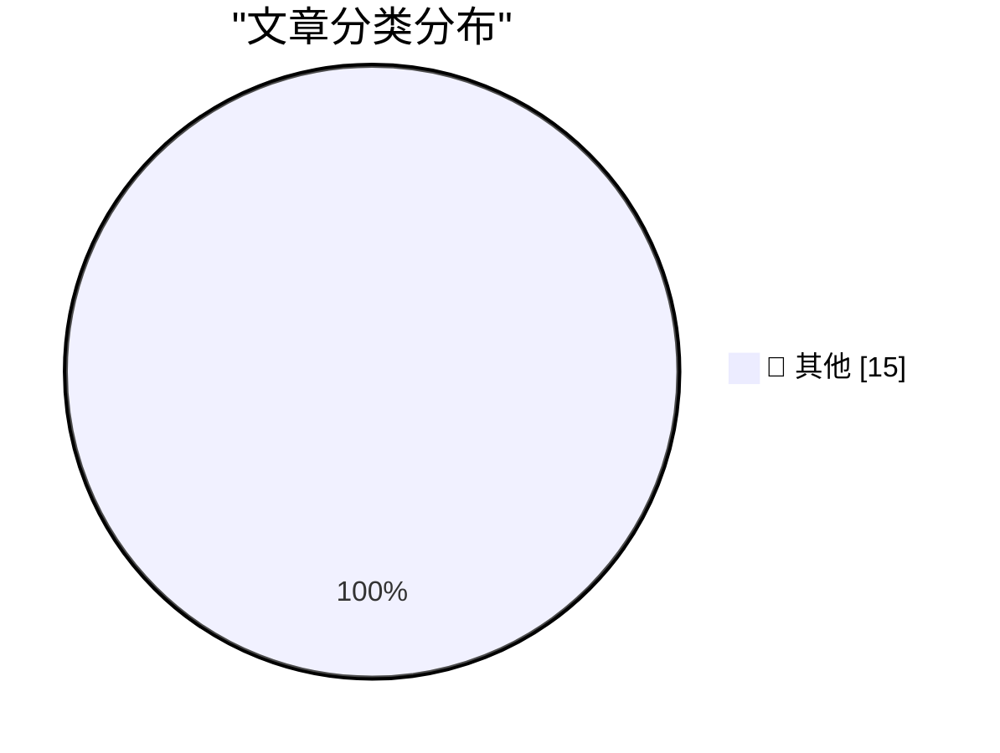

# 📰 AI 博客每日精选 — 2026-10-14

> 来自 Karpathy 推荐的 92 个顶级技术博客，AI 精选 Top 15

## 🏆 今日必读

🥇 **Redesigning source control at Anthropic**

[Redesigning source control at Anthropic](https://simonwillison.net/2026/Oct/13/redesigning-source-control-at-anthropic/) — simonwillison.net · 15 小时前 · 📝 其他

> Redesigning source control at Anthropic

🥈 **llm-gemini 0.35**

[llm-gemini 0.35](https://simonwillison.net/2026/Oct/13/llm-gemini/) — simonwillison.net · 16 小时前 · 📝 其他

> llm-gemini 0.35

🥉 **Quoting Geoffrey Huntley**

[Quoting Geoffrey Huntley](https://simonwillison.net/2026/Oct/13/geoffrey-huntley/) — simonwillison.net · 1 天前 · 📝 其他

> Quoting Geoffrey Huntley

---

## 📊 数据概览

| 扫描源 | 抓取文章 | 时间范围 | 精选 |
|:---:|:---:|:---:|:---:|
| 81/92 | 2488 篇 → 30 篇 | 48h | **15 篇** |

### 分类分布

---

## 📝 其他

### 1. Redesigning source control at Anthropic

[Redesigning source control at Anthropic](https://simonwillison.net/2026/Oct/13/redesigning-source-control-at-anthropic/) — **simonwillison.net** · 15 小时前 · ⭐ 15/30

> Redesigning source control at Anthropic

---

### 2. llm-gemini 0.35

[llm-gemini 0.35](https://simonwillison.net/2026/Oct/13/llm-gemini/) — **simonwillison.net** · 16 小时前 · ⭐ 15/30

> llm-gemini 0.35

---

### 3. Quoting Geoffrey Huntley

[Quoting Geoffrey Huntley](https://simonwillison.net/2026/Oct/13/geoffrey-huntley/) — **simonwillison.net** · 1 天前 · ⭐ 15/30

> Quoting Geoffrey Huntley

---

### 4. web-edit 0.1a1

[web-edit 0.1a1](https://simonwillison.net/2026/Oct/13/web-edit/) — **simonwillison.net** · 1 天前 · ⭐ 15/30

> web-edit 0.1a1

---

### 5. llm-meta-ai 0.2

[llm-meta-ai 0.2](https://simonwillison.net/2026/Oct/12/llm-meta-ai/) — **simonwillison.net** · 1 天前 · ⭐ 15/30

> llm-meta-ai 0.2

---

### 6. Hello Python 3.15, goodbye 3.10, and now I can use 3.11

[Hello Python 3.15, goodbye 3.10, and now I can use 3.11](https://simonwillison.net/2026/Oct/12/python-3-15/) — **simonwillison.net** · 1 天前 · ⭐ 15/30

> Hello Python 3.15, goodbye 3.10, and now I can use 3.11

---

### 7. Profiling web-edit with Python 3.15: flame graphs and source heatmaps

[Profiling web-edit with Python 3.15: flame graphs and source heatmaps](https://simonwillison.net/2026/Oct/12/python-3-15-web-edit-profiling/) — **simonwillison.net** · 1 天前 · ⭐ 15/30

> Profiling web-edit with Python 3.15: flame graphs and source heatmaps

---

### 8. web-edit 0.1a0

[web-edit 0.1a0](https://simonwillison.net/2026/Oct/12/web-edit/) — **simonwillison.net** · 1 天前 · ⭐ 15/30

> web-edit 0.1a0

---

### 9. Formlabs dropped the Raspberry Pi on the way to a $699 SLA printer

[Formlabs dropped the Raspberry Pi on the way to a $699 SLA printer](https://www.jeffgeerling.com/blog/2026/formlabs-form-studio-1-resin-printer/) — **jeffgeerling.com** · 1 小时前 · ⭐ 15/30

> Formlabs dropped the Raspberry Pi on the way to a $699 SLA printer

---

### 10. U.K. Sanctions Cryptomus for RU Money Laundering

[U.K. Sanctions Cryptomus for RU Money Laundering](https://krebsonsecurity.com/2026/10/u-k-sanctions-cryptomus-for-ru-money-laundering/) — **krebsonsecurity.com** · 21 分钟前 · ⭐ 15/30

> U.K. Sanctions Cryptomus for RU Money Laundering

---

### 11. Microsoft Patches More Than 1,400 Security Flaws

[Microsoft Patches More Than 1,400 Security Flaws](https://krebsonsecurity.com/2026/10/microsoft-patches-more-than-1400-security-flaws/) — **krebsonsecurity.com** · 15 小时前 · ⭐ 15/30

> Microsoft Patches More Than 1,400 Security Flaws

---

### 12. Apple HomeView

[Apple HomeView](https://www.apple.com/newsroom/2026/10/meet-apple-homeview-a-new-way-to-enjoy-entertainment-and-manage-the-home/) — **daringfireball.net** · 23 小时前 · ⭐ 15/30

> Apple HomeView

---

### 13. Mark Stephens, a.k.a. Robert X. Cringely, Died at 73

[Mark Stephens, a.k.a. Robert X. Cringely, Died at 73](https://www.facebook.com/story.php?story_fbid=pfbid0YbCLrAJfBirAWuPBy4a7pauaQ6gHkAPUwtbzyg2wAjeMcruFC7dWUZKQJKkNChP9l&amp;id=536506060&amp;_rdr) — **daringfireball.net** · 1 天前 · ⭐ 15/30

> Mark Stephens, a.k.a. Robert X. Cringely, Died at 73

---

### 14. The Last Answer

[The Last Answer](https://idiallo.com/blog/the-last-answer) — **idiallo.com** · 1 天前 · ⭐ 15/30

> The Last Answer

---

### 15. Pluralistic: Bundestrojaner (13 Oct 2026)

[Pluralistic: Bundestrojaner (13 Oct 2026)](https://pluralistic.net/2026/10/13/petards-r-us/) — **pluralistic.net** · 1 天前 · ⭐ 15/30

> Pluralistic: Bundestrojaner (13 Oct 2026)

---

*生成于 2026-10-14 14:44 | 扫描 81 源 → 获取 2488 篇 → 精选 15 篇*
*基于 [Hacker News Popularity Contest 2025](https://refactoringenglish.com/tools/hn-popularity/) RSS 源列表，由 [Andrej Karpathy](https://x.com/karpathy) 推荐*
*由「懂点儿AI」制作，欢迎关注同名微信公众号获取更多 AI 实用技巧 💡*
